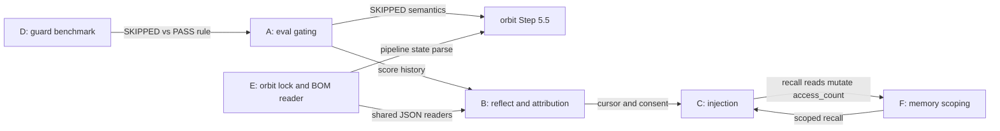

# Research memo for epic-harness 0.9.0: pipeline-changing areas A to F

Date: 2026-11-16. Role: researcher. Audience: tech lead writing ADRs and specs.

Method and honesty notes. Repository facts were read from main at commit 74424a2 (read-only) and from `.lead/audit/all.json`. Literature was gathered with the built-in WebSearch and WebFetch tools: the Exa MCP server required OAuth that was not available in this session, and no Tavily MCP tools were present, so the documented fallback order ended at the built-in tools. Search queries used generic technical phrasing only. Every cited claim below was read on the fetched page unless marked "secondary" (seen only in a search-result summary or a third-party write-up) or "unconfirmed" (could not be sourced). Where a fetched page did not contain a detail I wanted, I say so instead of filling it from memory. The Dataflow Model 2015 PDF could not be decoded by the fetch tool, so claims about it come from a search summary and are marked secondary.

Everything here is design input. Anything touching the guard, orbit lock, or memory store needs human review before it ships.

## Area A: Eval regression gating and benchmark noise

Issues: #289 (audit issue 179), #374 (issue 275), #284 (PR 380), #380.

### Current design and defect

`epic eval` runs producers per dimension in `src/eval/mod.rs:118-135`, and when `--dimension regression` is passed it skips every producer, then calls `compute_regression` with an empty slice at `src/eval/mod.rs:147-153`. `compute_regression` (`src/eval/runner.rs:184-216`) iterates only over results that have a baseline entry, so an empty input yields empty deltas and PASS. The regression test is a single-sample comparison `delta < -threshold` on a 0/1 score (`runner.rs:191`) with `threshold` unvalidated (`src/eval/config.rs:70-71`), so `.nan` or `.inf` makes the comparison always false and every regression passes. `run_performance` (`runner.rs:80-114`) scores exit status only; `max_regression_pct` (`config.rs:51-55`) is dead config and is never passed into `ResolvedCommands` (`config.rs:381-387`), so no latency gate ever existed. The default threshold is 0.05 (`config.rs:114-116`, `config.rs:188`), which contradicts the 0.02 stated in the contributor docs for #380. The audit marks the #289 fix as correct on the empty-delta point but flags that a global "everything skipped exit 1" rule would fail orbit Step 5.5 for scaffolded projects without benchmarks, and flags #374 as gating on noisy wall-clock time with a 0 ms baseline hazard.

### What the literature and practice say

1. Criterion.rs treats a performance change as real only after bootstrap resampling of both runs, a T-test statistic, and a probability that the difference is chance, and it ignores changes inside a configurable noise threshold (its example is plus or minus 1%). The page names `warm_up_time`, `measurement_time`, and `sample_size` but gives no defaults for the noise threshold. Source: Criterion.rs book, Analysis Process (undated page). https://bheisler.github.io/criterion.rs/book/analysis.html
2. Hyperfine runs warmups on request, performs at least 10 runs by default (targeting about 3 seconds of total runtime), and does statistical outlier detection to flag interference from other programs and caching. Source: hyperfine README (undated). https://github.com/sharkdp/hyperfine
3. MongoDB replaced threshold comparisons with E-Divisive Means change point detection over the history of results, with a human reviewing flagged change points. The authors state it "dramatically dropped our false positive rate" and caught smaller regressions, but the abstract gives no figures. Daly, Brown, Ingo, O'Leary, Bradford, arXiv 2020. https://arxiv.org/abs/2003.00584 (the venue is not stated on the fetched page; I recall ICPE 2020, unconfirmed).
4. Hunter (DataStax and collaborators) modifies E-Divisive by replacing the randomized permutation significance test with a Student's t-test, because the permutation approach was not deterministic at a reasonable iteration count. Fleming et al., arXiv January 2023. https://arxiv.org/abs/2301.03034
5. Mozilla's sheriffing process uses a minimum change size per harness (AWSY at least 0.25%, installer size at least 100 kB, Talos, Browsertime and build metrics at least 2%, Dromaeo 5%), asks sheriffs to wait for about 12 future data points before trusting a change, and says retriggering jobs adds data points. It says invalid alerts mostly come from unstable tests. The fetched doc does not mention a t-test; a t-test over about 12 prior and up to 11 later revisions appears only in a search summary (secondary). Source: Firefox Source Docs, Performance Sheriffing (undated). https://firefox-source-docs.mozilla.org/testing/perfdocs/perf-sheriffing.html
6. For stochastic agent evals, Anthropic recommends several trials per task, distinguishes pass@k (at least one success) from pass^k (all k succeed), and gives the example that a 75% per-trial rate gives pass^3 of about 42%. It states regression evals should sit near 100% pass rate and warns that correlated failures from shared state make trials non-independent. Source: Anthropic Engineering, "Demystifying evals for AI agents", 9 January 2026. https://www.anthropic.com/engineering/demystifying-evals-for-ai-agents
7. tau-bench introduced pass^k and reported that agent success falls sharply across repeated trials (pass^8 below 25% in its retail domain). Yao, Shinn, Razavi, Narasimhan, arXiv June 2024. https://arxiv.org/abs/2406.12045
8. Evan Miller argues LLM eval scores need error bars and gives formulas for analyzing eval data, comparing two models, and planning evals; the fetched abstract does not itemize which techniques (paired differences, clustering) are included, so I do not claim them. arXiv November 2024. https://arxiv.org/abs/2411.00640
9. Google reports that larger tests are more flaky and that when a stable test turned flaky and was traceable to a code change, a production bug was the cause about one sixth of the time. The overall flaky percentage was not on the fetched page (unconfirmed). Source: Google Testing Blog, 17 April 2017. https://testing.googleblog.com/2017/04/where-do-our-flaky-tests-come-from.html

### Design options

- A1, validate and fail closed only. Reject non-finite or out-of-range thresholds at config load (#284 logic), make `--dimension regression` run all producers and compare, treat a regression run with zero comparable dimensions as an explicit SKIPPED verdict (not PASS, not hard FAIL), and make the dead `max_regression_pct` either rejected with a warning or removed. Trade-off: no new statistics, smallest blast radius, but wall-clock performance stays ungated.
- A2, A1 plus opt-in measured metrics. Performance commands may emit a metric (for example JSON with named values and a sample count). The harness gates only on explicitly reported metrics, with N repeated runs, a median and spread, and a per-metric relative noise floor in the style of Mozilla and Criterion. No automatic wall-clock fallback and no top-level `duration_ms` pickup from old baselines. Trade-off: moderate code, requires baseline schema versioning, avoids the flaky-gate regression the audit predicts for #374.
- A3, change point detection over the baseline history. Keep the per-run history and apply an E-Divisive or Hunter-style t-test change point scan. Trade-off: best false-positive behavior per the MongoDB report, but needs a long history, is stateful, and is overkill for a harness whose projects often have few runs.

### Recommendation

A1 now, with A2 as the 0.9.0 stretch and A3 deferred. Rationale: the three confirmed defects (#289, #284, dead config) are validation and semantics bugs, not statistics problems. The literature consistently says single-sample thresholds on noisy timing are the wrong tool (items 1 to 5), and the cheapest sound response is to refuse to gate on timing unless the project supplies repeated, explicitly reported measurements. For pass/fail semantics use three verdicts (PASS, FAIL, SKIPPED) and let `orbit` treat SKIPPED as non-blocking but visible, which resolves the audit's orbit Step 5.5 concern without a policy reversal. For agent-style benchmark commands, expose `trials` and a `pass^k` or `pass@k` mode (item 6) rather than a single exit code.

### Open questions

- Should SKIPPED on an all-empty regression run be PASS-with-warning or a distinct exit code for CI? Needs a maintainer call because exit codes are public contract.
- What is the minimum sample count below which the harness refuses to gate (Hyperfine uses 10 by default, item 2; Mozilla waits for about 12 points, item 5)? Neither number is validated for this project.
- Baseline schema: is a `schema_version` bump acceptable, and how are old baselines handled?

## Area B: Self-evolving skill attribution and reflection watermarks

Issues: #323 (issue 218), #371 (issue 272).

### Current design and defect

Reflection keeps observations strictly newer than a stored watermark: `filter_past_watermark` uses lexical `>` on ISO timestamps (`src/hooks/reflect.rs:849-856`), and the new watermark is the max timestamp of the batch, written before analysis so a crash cannot double-count (`reflect.rs:965-985`, the code comment documents this trade as deliberate). `now_iso` has one-second precision (`src/shared/helpers.rs:87-91`), so observations written in the same second after a reflect round are dropped forever. Skill attribution assigns each under-evaluation skill to an active or holdout arm per day by `hash(skill, date) % modulus == 0` (`src/evolve/metrics.rs:285-286`, modulus in `src/config.rs:219-220`), and compares `avg_score_with` to `avg_score_without` (`src/shared/evolution.rs:244`), flagging but never evicting (AGENTS.md, Skill Attribution). For #371, docs say `projects/{slug}/.cross-project-enabled` and `~/.harness/global_patterns.jsonl`, but code uses `global/.cross-project-enabled` and `global/patterns.jsonl` (`src/shared/paths.rs:271-283`, read in `src/hooks/resume.rs:147,164`), so following the docs shares nothing (fails closed). The audit rates the #323 idea (id-based cursor committed with the evolution record) as right but the PR as overreach (removes the JSONL fallback, drops the "today" scope, resets the cursor on merges which re-inflates `total_sessions`).

### What the literature and practice say

1. SkillOpt (cited in AGENTS.md) treats the skill document as trainable state: a separate optimizer proposes bounded add, delete, or replace edits, an edit is kept only if it strictly improves a held-out validation score, rejected edits go to a buffer, a textual learning-rate budget limits edit size, and an epoch-wise slow update stabilizes training. Reported on 6 benchmarks, 7 models, 3 harnesses, best or tied in 52 of 52 cells. Yang et al., arXiv 2605.23904, 22 May 2026 (v2 25 May). https://arxiv.org/abs/2605.23904 Note: the held-out validation gate is what the repo's holdout arm approximates, but SkillOpt gates before deployment while the repo measures after.
2. Voyager keeps an ever-growing library of executable skills retrieved by task, refined by environment feedback and self-verification, with no fine-tuning. Wang et al., arXiv 2305.16291, 2023. https://arxiv.org/abs/2305.16291
3. ExpeL gathers experiences and extracts natural-language insights, recalled at inference without parameter updates. Zhao et al., AAAI-24, arXiv 2308.10144. https://arxiv.org/abs/2308.10144
4. Agent Workflow Memory induces reusable workflows from past trajectories and supplies them selectively; it reports 24.6% (Mind2Web) and 51.1% (WebArena) relative success-rate gains. Wang, Mao, Fried, Neubig, arXiv 2409.07429, September 2024. https://arxiv.org/abs/2409.07429
5. ADAS has a meta agent write new agents as code against an archive of earlier discoveries. Hu, Lu, Clune, arXiv 2408.08435, 2024. https://arxiv.org/abs/2408.08435 (relevant mainly as precedent for archive-guided search, not for statistics).
6. Always-valid p-values and confidence intervals remain valid under continuous monitoring and optional stopping, which standard fixed-horizon tests do not. Johari, Pekelis, Walsh, arXiv 1512.04922, 2015. https://arxiv.org/abs/1512.04922 This matters because the repo's verdict logic peeks at running averages each session (`sessions_active >= 3`, `sessions_holdout >= 2`).
7. CUPED reduces metric variance by adjusting outcomes with a pre-experiment covariate, with reduction proportional to the correlation; the covariate must not be affected by the treatment. Deng, Xu, Kohavi, Walker, WSDM 2013. Paper page: https://exp-platform.com/cuped/ (details come from search summaries and vendor pages, secondary; the paper itself was not read). Applicability here is speculative: the natural covariate would be the same session-score metric on the prior day or prior sessions, unconfirmed as useful at 3 to 12 sessions.
8. Flink documents a watermark as a declaration that event time has reached t and that no further elements with timestamp at or below t are expected; elements arriving after are "late" and handled by an explicit allowed-lateness policy, and delaying watermarks too much is not desirable. Source: Apache Flink docs, Timely Stream Processing (current stable). https://nightlies.apache.org/flink/flink-docs-stable/docs/concepts/time/
9. The Dataflow Model paper treats watermarks as a heuristic estimate of completeness, not a guarantee, so late data must be handled by policy (search summary, secondary; PDF not decodable). Akidau et al., VLDB 2015. https://www.vldb.org/pvldb/vol8/p1792-Akidau.pdf
10. OWASP lists multi-tenant or cross-group leakage in shared stores as a risk and recommends permission-aware, logically partitioned stores. Source for the consent point of #371: OWASP LLM08:2025. https://genai.owasp.org/llmrisk/llm082025-vector-and-embedding-weaknesses/

### Design options

- B1, id cursor with a tie-breaker, keep fallback. Replace the second-resolution watermark with a monotonic cursor over a strictly increasing row id (SQLite rowid or autoincrement id) committed in the same transaction as the evolution record, keep the JSONL fallback with a (timestamp, line index or file offset) pair, do not reset on merge, and make migrations carry the cursor forward. Trade-off: closes the same-second loss exactly (the Flink idea that late data needs an explicit policy, applied as a deterministic cursor instead of a heuristic), needs a schema addition, and the JSONL path needs its own tie-break.
- B2, keep timestamp watermark but use `>=` plus a seen-id set for the boundary second. Trade-off: no schema change, dedup state must be persisted and bounded, simplest to reason about for the single-writer case, weaker under concurrent sessions (AGENTS.md notes concurrent session files).
- B3, move attribution verdicts to an always-valid sequential test with a minimum effect size and variance reduction via the previous-session score covariate (CUPED-like). Trade-off: more principled flagging at 3 to 12 samples, but adds statistics code for a signal that is deliberately reported not enforced.

For #371: C1 docs-only fix to match code (global marker, `global/patterns.jsonl`); C2 accept both markers as the PR does; C3 per-project marker as canonical with an explicit one-time migration.

### Recommendation

B1 for the cursor, scoped as its own ADR, rejecting the PR's removal of the fallback, its "today" scope drop, and its cursor reset on merge (the audit's evidence). Leave attribution as is for 0.9.0 and record B3 as a future option, because AGENTS.md already states that verdicts are reported not enforced, and the sequential-testing literature (item 6) only matters if the verdict starts to gate behavior. For #371 choose C1: it matches the runtime that has fail-closed consent, avoids a consent-scope change on a privacy-relevant export, and is the smallest change. If maintainers prefer per-project consent, take C3 deliberately, not C2, since accepting either marker silently widens consent.

### Open questions

- Is the SQLite observation table append-only with monotonic ids across merges and migrations (needed for B1)? Not verified.
- Which is canonical for cross-project consent, global or per project? Maintainer decision.
- At the current 12-session settlement, is any variance-reduction method worth it? Unconfirmed; would need replayed historical metrics.

## Area C: Per-prompt memory and skill injection

Issues: #392 and #276.

### Current design and defect

Today injection happens once, at SessionStart: `epic resume` prints active evolved skill bodies to stdout, with holdout-arm skills withheld, bounded by `inject_per_skill_chars` and `inject_total_chars` (default 10,000, `src/config.rs:38,48`). The Claude plugin hook table (`.claude-plugin/hooks.json`) registers SessionStart, PreToolUse, PostToolUse, PreCompact and others but no UserPromptSubmit. PR 392 adds a UserPromptSubmit hook that injects up to 10,000 characters of skill bodies and memory previews on every prompt. The audit flags per-prompt `smart_recall` incrementing `access_count` and `accessed_at` (skewing recall ranking and decay), edits to `_dispatch` instructions, weakened plugin-asset tests, an inline JavaScript launcher, and stacked unrelated commits. Verdict: a feature request needing a product decision.

### What the literature and practice say

1. Anthropic defines context engineering as curating the smallest set of high-signal tokens, notes recall falls as the window fills, and recommends just-in-time retrieval (lightweight references loaded on demand) and compaction over pre-loading everything. Anthropic Engineering, 29 September 2025. https://www.anthropic.com/engineering/effective-context-engineering-for-ai-agents
2. Agent Skills use three-level progressive disclosure: name and description in the system prompt, the SKILL.md body only when judged relevant, linked files only when needed. It also warns that untrusted skills can direct data exfiltration. Anthropic Engineering, 16 October 2025. https://www.anthropic.com/engineering/equipping-agents-for-the-real-world-with-agent-skills
3. Chroma tested 18 models and reports that performance degraded with input length in every experiment, that even one distractor reduces accuracy, and that on LongMemEval all models scored higher on a focused prompt (about 300 tokens) than on the full one (about 113k tokens). The authors note their tasks were simple and controlled and that they do not explain the mechanism. Chroma, 14 July 2025. https://www.trychroma.com/research/context-rot
4. Models use information best at the start and end of long inputs and worst in the middle. Liu et al., TACL, arXiv 2307.03172, 2023. https://arxiv.org/abs/2307.03172
5. Self-RAG trains a model to decide on demand whether to retrieve, using reflection tokens, instead of always attaching a fixed number of passages. Asai et al., arXiv 2310.11511, October 2023. https://arxiv.org/abs/2310.11511
6. Adaptive-RAG uses a small classifier to choose no retrieval, single-step, or multi-step retrieval by query complexity, reported to improve efficiency and accuracy (no numbers on the fetched page). Jeong et al., NAACL 2024, arXiv 2403.14403. https://arxiv.org/abs/2403.14403
7. OWASP LLM01:2025 says indirect prompt injection arises when the model processes external content with embedded instructions, that it cannot be fully prevented, and recommends separating and labeling untrusted content, least privilege, and human approval for high-risk actions. https://genai.owasp.org/llmrisk/llm01-prompt-injection/
8. AgentPoison poisons an agent's long-term memory or knowledge base and reports above 80% average attack success on three agents with under 0.1% poison rate and under 1% benign impact. Chen et al., arXiv 2407.12784, July 2024. https://arxiv.org/abs/2407.12784
9. MINJA injects malicious records into an agent's memory bank through queries only, so a normal user can poison memory later retrieved for other users. Dong et al., arXiv 2503.03704, March 2025 (v5 February 2026); success figures were not on the fetched page. https://arxiv.org/abs/2503.03704
10. The Claude memory tool documentation puts security of memory operations on the application: validate paths, cap file sizes and the number of characters returned by view, expire stale memory, and strip sensitive data. It does not discuss prompt injection through memory content (unconfirmed whether other pages do). https://platform.claude.com/docs/en/agents-and-tools/tool-use/memory-tool

### Design options

- C1, do not add a per-prompt hook in 0.9.0; improve what exists. Keep SessionStart injection, make `_dispatch` pull memory on demand through `epic mem recall` (already described in AGENTS.md), and add a read-only recall mode that does not bump `access_count`. Trade-off: no new surface, matches progressive disclosure, relies on the model choosing to recall.
- C2, gated per-prompt hook. Add UserPromptSubmit but gate it: run only when a cheap deterministic trigger fires (task keyword hit above a score floor, new topic versus last injected), inject titles and one-line hints with ids (not bodies) capped around 1 to 2 kB, dedupe within a session, never mutate access counters from the hook, and wrap injected text as untrusted data. Trade-off: closer to Self-RAG and Adaptive-RAG gating, still adds a hook, its cost and hit rate are unmeasured here.
- C3, PR 392 as proposed (up to 10k chars every prompt). Trade-off: simplest, directly conflicts with items 1 to 4 and amplifies item 8 and 9 risks every turn.

### Recommendation

C1 for 0.9.0, with C2 specified as a follow-up ADR only if a measurement shows recall is being missed. Rationale: three independent sources (items 1, 3, 4) say always-on context hurts, and this repo's own default total budget of 10,000 characters injected on every prompt would repeat that cost each turn. The poisoning papers (items 8, 9) and OWASP (item 7) mean any text from a memory store the model did not author this turn should be framed as untrusted reference, which matters more when it is injected automatically. Whatever ships, the read path must be side-effect free for ranking, otherwise injection feeds back into recall scores.

### Open questions

- Is there any measurement that the model fails to call recall when relevant? None found; would need the observe logs.
- Who can write memory nodes (the model, other sessions, imported projects)? That defines the poisoning exposure. Not verified in code.
- Hook portability: the Codex plugin hook table was not examined for a prompt-submit event equivalent.

## Area D: Guard benchmark validity

Issue: #373 (issue 274).

### Current design and defect

Native guard has two block rules (`src/hooks/guard.rs:13-22`: `rm -rf /` and `DROP DATABASE|TABLE ... prod`) plus configurable YAML rules. The README advertises 50 of 50 interception, but `benchmarks/ab/guard_challenge.py` classifies with its own Python regex list and never calls the binary, so it validates a surrogate, not the product. The PR rewrites the benchmark to spawn the guard binary (good) and also adds 13 blocking and 5 warning production rules (policy change, false-positive risk, unrequested). The audit says split it.

### What the literature and practice say

1. CARE (pre-execution shell command verification) reports on a balanced main split F1 85.64%, false-positive rate 0.91%, mean latency 2.32 ms; its static profile reached F1 84.99% at 0.34 ms but with 37.33% realised harm on RedCode-gen. Liu et al., ISSRE 2026, arXiv 2607.21642, submitted 21 July 2026. https://arxiv.org/abs/2607.21642 A secondary write-up gives a 75.91% detection rate and 45.90% FPR for a content-safety model on shell commands; I could not confirm those on the paper's abstract, so treat them as unconfirmed. https://codex.danielvaughan.com/2026/08/13/care-pre-execution-command-verification-shell-llm-agents-codex-cli-pretooluse-hooks-static-verification/
2. Anthropic's auto mode post reports a two-stage classifier with 8.5% FPR at stage 1 alone and 0.4% FPR for the full pipeline on 10,000 real internal actions, and false-negative rates of 6.6% (stage 1) and 17% (full) on 52 real overeager actions, calling the 17% "the honest number". It uses three datasets (real traffic, curated real incidents, synthetic exfiltration). Anthropic Engineering, 25 March 2026. https://www.anthropic.com/engineering/claude-code-auto-mode
3. Anthropic's sandboxing post says approval prompts cause approval fatigue and that OS-level sandboxing reduced permission prompts by 84% in internal use, covering spawned subprocesses. It does not compare sandboxing to command deny lists, so any such comparison is my inference. Anthropic Engineering, 20 October 2025. https://www.anthropic.com/engineering/claude-code-sandboxing
4. ToolEmu evaluates agent risk with an LM-emulated sandbox (36 tools, 144 cases) and found even the safest tested agent failed 23.9% of the time by its automatic evaluator; 68.8% of flagged failures were judged valid by humans. Ruan et al., arXiv 2309.15817, 2023 (revised 2024). https://arxiv.org/abs/2309.15817
5. A search summary of the Parallax paper reports 18 of 50 legitimate actions blocked (36%) under a maximum-security configuration; the fetched abstract only confirmed "zero false positives" in the default configuration, so the 36% figure is secondary and unconfirmed. Fokou, arXiv 2604.12986, April 2026. https://arxiv.org/abs/2604.12986
6. Open Policy Agent treats policies as code with unit tests (`opa test`), a `--fail-on-empty` flag so a pipeline that runs no tests fails, coverage reporting, and per-test SKIPPED. https://www.openpolicyagent.org/docs/policy-testing This is directly analogous to the harness's SKIPPED-versus-PASS question in area A.
7. The oracle problem: automated test oracles are limited and the final source of oracle information is often human. Barr, Harman, McMinn, Shahbaz, Yoo, IEEE TSE 41(5), 2015, DOI 10.1109/TSE.2014.2372785 (metadata from search results). https://dblp.org/rec/journals/tse/BarrHMSY15.html A benchmark whose oracle is a reimplementation of the unit under test is a circular oracle.

### Design options

- D1, honest benchmark only. Drive the real hook binary (stdin JSON, exit code and stdout as the verdict), keep the dataset, report block, warn, and allow per case, correct the README to the measured native coverage, and add a benign corpus so the report carries a false-positive rate next to recall. No policy change. Trade-off: the headline number drops from 50 of 50 to whatever native rules really catch, which is the point.
- D2, D1 plus new builtin rules shipped as opt-in presets. Rules live in an explicit preset (for example loaded through `.harness/guard-rules.yaml`), each rule paired with at least one allow-case in the benign corpus. Trade-off: policy stays out of default behavior, users opt in knowing the false-positive risk.
- D3, PR as proposed (new default builtin rules). Trade-off: higher default recall, unquantified FPR for every user, no benign corpus evidence.

### Recommendation

D1 for 0.9.0, D2 as a separate maintainer-approved change. Rationale: the audit's evidence that the benchmark tests a surrogate is a validity defect (item 7), independent of any rule. Items 1 and 2 show that mature guards report FPR and FNR on real or curated data and call the false-negative number out; a guard benchmark without a benign set cannot show cost. Also note guard blocking is a defense-in-depth layer: item 3 argues OS-level isolation does the heavy lifting, so recall of regex rules should not be oversold in the README. Policy-as-code practice (item 6) supports a `--fail-on-empty` equivalent so a benchmark that executes zero cases fails.

### Open questions

- Source of a realistic benign command corpus (own observe logs, which need masking, versus a public corpus). Unconfirmed availability.
- Do warn verdicts count as interception in the headline metric? Needs a definition in the ADR.
- Windows and PowerShell command forms are not covered by the current dataset (not checked in detail).

## Area E: Orchestration locks and stale agents

Issues: #348 (issue 247), #345 (issue 244), #282 (PR 393).

### Current design and defect

The orbit lock is a file `.orbit.lock` created with `create_new`; acquisition scans for a running `PIPELINE-*.json` only when the lock file already exists (`src/shared/orbit.rs:174-183`), so a fresh running pipeline with no lock file is admitted, and a documented startup window remains (`orbit.rs:170-171` ponytail comment). Unlock is unconditional by design because it runs on abort and after crashes (`orbit.rs:197-200`, advisory note at `:213-215`). Pipeline files are parsed with `serde_json::from_str` (`orbit.rs:72`), which rejects a leading U+FEFF, so a PowerShell-written file is treated as absent and the lock is reclaimed (#282). Orchestrator cleanup marks a Running agent Done if `started_at` is older than 30 minutes (`src/orchestrate/state.rs:482-496`) although the comment says heartbeat; the heartbeat is only consulted later for directory removal (`state.rs:536-545`), and heartbeats are refreshed by the pre-invocation hook only (`src/orchestrate/mod.rs:126-139`). The audit: #345 real but low severity, PR changes cleanup semantics broadly; #348 partly real (lock-less admission), PR reverses the unlock design with new env var and admission lock; #393 helper is correct and independent.

### What the literature and practice say

1. Kleppmann argues that a lease can expire while its holder is paused (GC, network delay), and that the safe fix is a strictly increasing fencing token issued with each acquisition and checked by the protected resource, which rejects lower tokens. Without a checking resource, expiry-based locks are unsafe for correctness. Kleppmann, "How to do distributed locking", 8 February 2016. https://martin.kleppmann.com/2016/02/08/how-to-do-distributed-locking.html
2. The phi accrual failure detector replaces a binary alive-or-dead timeout with a continuous suspicion level derived from observed heartbeat inter-arrival times, so the application chooses its own threshold. Hayashibara, Defago, Yared, Katayama, SRDS 2004, pp. 66-78 (from search results, secondary; the paper text was not read). https://dspace.jaist.ac.jp/dspace/handle/10119/4784
3. Rust stabilized `File::lock`, `try_lock`, and `unlock` in 1.89.0, mapped to `flock` on Unix and `LockFileEx` on Windows. The lock is advisory or mandatory depending on platform, is released when the handle is closed or `unlock` is called, and locking an append-only handle fails on Windows. Network filesystem behavior and process-crash behavior are not stated on the page (unconfirmed). https://doc.rust-lang.org/std/fs/struct.File.html
4. Linux `open(2)`: `O_CREAT|O_EXCL` fails with EEXIST if the path exists; on NFS it is only supported with NFSv3 or later on kernel 2.6 or later, otherwise lock code "will contain a race condition", and the man page describes link(2) based lockfiles as the portable alternative. https://man7.org/linux/man-pages/man2/open.2.html
5. RFC 8259 section 8.1 says implementations MUST NOT add a BOM to networked JSON, and that parsers may ignore a BOM. RFC 8259, December 2017. https://www.rfc-editor.org/rfc/rfc8259#section-8.1
6. In Windows PowerShell 5.1 any Unicode encoding except UTF7 creates a BOM, `Out-File` and `>` write UTF-16LE, and `-Encoding UTF8` means UTF-8 with BOM; PowerShell 6 and later default to UTF-8 without BOM. Microsoft Learn, about_Character_Encoding (page updated 2025). https://learn.microsoft.com/en-us/powershell/module/microsoft.powershell.core/about/about_character_encoding

### Design options

- E1, minimal fixes in place. Orbit: always run the running-pipeline scan before acquiring, keep unlock unconditional. Orchestrate: compute staleness from the newer of `started_at` and the `status.json` heartbeat. BOM: add the independent `parse_persisted_json` helper that strips one leading BOM and use it at all state readers. Trade-off: closes the confirmed defects with no new files or env vars, keeps the documented startup ceiling.
- E2, kernel lock plus lease file. Hold an OS advisory lock (`File::try_lock`) on the lock file for the lifetime of the orbit process so crash release is automatic, plus a heartbeat in the pipeline file for visibility, and a monotonic generation counter written into pipeline state as a fencing token that writers of PIPELINE files check. Trade-off: removes the startup window and stale-lock reasoning, but orbit runs as short-lived CLI invocations (the code comment says the lock must outlive the CLI process), so a process-held kernel lock does not fit without a long-lived owner.
- E3, PR 348 as proposed (admission lock, 2-minute reservation, owner env var, unlock fails while running). Trade-off: stronger exclusion, but reverses the explicit abort and crash design and adds an env-gated release path.

### Recommendation

E1. Rationale: orbit's lock is deliberately advisory and file-based because owners are short-lived CLIs (`orbit.rs` comments). Fencing (item 1) only helps when the protected resource checks the token, so the cheap, relevant adoption is a generation number in the PIPELINE state that `update` calls compare, deferred unless overlapping writes are observed in practice. For heartbeat logic, the accrual idea (item 2) argues against a hard-coded 30-minute `started_at` rule, but a full phi detector is unwarranted when heartbeats come only from a pre-invocation hook: use max of `started_at` and last heartbeat, keep one threshold. For BOM, accept a leading BOM on read (item 5 permits it) and keep writing without one, noting Windows PowerShell 5.1 will produce BOM or UTF-16 files (item 6, UTF-16 is not handled by the helper and is worth a test).

### Open questions

- Should the BOM helper also detect UTF-16LE from `Out-File`, which the PowerShell docs say is the 5.1 default for redirection? Not covered by the PR per the audit.
- Is `fs::remove_dir_all` on agent directories safe if a heartbeat arrives mid-cleanup? Race not analyzed.
- Does any supported deployment put the state dir on a network filesystem (item 4 caveat)? Unknown.

## Area F: Memory recall project scoping

Issues: #331 (issue 228), #332 (issue 229), #333 (issue 230).

### Current design and defect

Recall with a hint first selects FTS rowids globally with `LIMIT limit*3` (`src/mem/store/recall.rs:41-46`) and only then filters by project with `projects LIKE '%proj%'` (`recall.rs:59-63`, also `:84-85` and `src/mem/store/search.rs:78,84`). Two defects: the global cap can be consumed entirely by other projects' rows so a project's matches are hidden (#333), and the LIKE against a comma-joined column matches substrings and treats `%` and `_` as wildcards (#331). The FTS table is an external-content table over `nodes` with columns `id, title, body, tags, projects` (`src/mem/store/schema.rs:27,125`). MCP graph augmentation appends up to five 1-hop neighbors with no project filter (`src/mem/mcp.rs:335-385`), leaking other projects (#332, scope part confirmed; "limit" overflow is documented design). The same substring pattern remains in decay (`src/mem/store/decay.rs:39,74-75`) per the audit. A code comment (`recall.rs:39-40`) says the two-step query avoids sqlx AnyPool issues with FTS joins.

### What the literature and practice say

1. SQLite FTS5 external-content tables are kept in sync by triggers the user writes, with `content_rowid` naming the key; a MATCH first obtains matching rowids from the index and then fetches values from the content table. The fetched text does not say whether extra predicates are applied before or after ranking and LIMIT (unconfirmed; verify with `EXPLAIN QUERY PLAN`). https://www.sqlite.org/fts5.html
2. FTS5 supports column filters in MATCH (`colname : term`, braces for several columns), so a project token stored in an indexed column can be constrained inside the full-text query. Same source as item 1.
3. `UNINDEXED` columns are stored but have no matchable tokens, so they cannot be used inside MATCH, only in a join or WHERE. Same source.
4. SQLite `instr(X,Y)` returns the 1-based position of Y in X, and the LIKE optimization is skipped when the pattern begins with a wildcard, so `%proj%` can never use an index. https://sqlite.org/lang_corefunc.html and https://www.sqlite.org/optoverview.html
5. MemGPT separates in-context and external memory tiers and moves data between them, describing memory as operating-system-style virtual context. Packer et al., arXiv 2310.08560, 2023. https://arxiv.org/abs/2310.08560 In Letta, memory blocks attached to an agent are in context and a block can be attached to several agents ("shared blocks"); the fetched page does not describe archival scoping or tags (unconfirmed). https://docs.letta.com/guides/agents/memory
6. Mem0 scopes by explicit identifiers (`user_id`, `agent_id`, `app_id`, `run_id`), applies them as filters at search time, leaves omitted fields unconstrained, and notes that `AND` across `user_id` and `agent_id` returns nothing for default-path memories. Mem0 paper reports 26% relative gain on LOCOMO (LLM-as-judge), 91% lower p95 latency and over 90% token savings versus full-context. Docs: https://docs.mem0.ai/platform/features/entity-scoped-memory ; paper: Chhikara et al., arXiv 2504.19413, April 2025, https://arxiv.org/abs/2504.19413
7. A-Mem links new memories to existing ones (Zettelkasten style) and lets additions update older notes, so scope boundaries need care when links can cross them. Xu et al., NeurIPS 2025, arXiv 2502.12110. https://arxiv.org/abs/2502.12110
8. Zep (Graphiti) is a temporal knowledge graph for agent memory, reporting 94.8% on DMR (versus 93.4% for MemGPT) and up to 18.5% higher accuracy with 90% lower latency on LongMemEval. Rasmussen et al., arXiv 2501.13956, January 2025. https://arxiv.org/abs/2501.13956 The fetched abstract does not describe tenant scoping (unconfirmed).
9. OWASP recommends permission-aware, logically partitioned vector stores because shared stores leak embeddings between groups. https://genai.owasp.org/llmrisk/llm082025-vector-and-embedding-weaknesses/

### Design options

- F1, minimal SQL fixes. Replace `LIKE '%x%'` everywhere (recall, search, decay) with exact membership `instr(',' || col || ',', ',' || ? || ',') > 0`, keep the two-step FTS query but over-fetch adaptively or loop until the project quota fills, and add a project filter (and the stale exclusion) to graph neighbors while keeping the existing limit semantics. Trade-off: smallest diff, still ranks globally first, so a very large other-project corpus can still starve a small project unless the over-fetch loops.
- F2, push the project predicate into the query. Join `nodes_fts` to `nodes` (or use `rowid IN (SELECT rowid FROM nodes WHERE exact-project-match)`) so ranking operates only on in-scope rows, as #333 proposes. Trade-off: correct results, depends on how SQLite plans MATCH with extra constraints (unconfirmed, item 1) and on the sqlx AnyPool concern in the code comment, so it needs a regression test with a project that owns only low-ranked rows.
- F3, normalize membership into a `node_projects(node_id, project)` table with an index, and optionally mirror the project as an FTS column filter. Trade-off: exact, indexable, supports a future per-project permission model, but needs a migration of the comma-joined column (human review required, runtime DB change) and breaks the "projects is a CSV" assumption in other readers.

### Recommendation

F2 with the F1 exact-membership predicate, plus the neighbor scope filter only (not the new limit semantics), with F3 recorded as the longer-term shape. Rationale: all three defects are confirmed and independent of the larger redesign. Mem0's explicit, always-applied filter model (item 6) and OWASP partitioning guidance (item 9) both say scope must be enforced in the query, not by post-filtering a global candidate set. The audit also confirms the instr membership logic is correct. Do the FTS join only after an `EXPLAIN QUERY PLAN` check and a starvation test, since SQLite's docs do not guarantee pre-filter behavior. Keep neighbor ordering by edge weight (the audit notes the PR loses it), and treat `limit` overflow by neighbors as documented behavior unless a maintainer redefines it.

### Open questions

- Behavior of MATCH plus an extra predicate and `ORDER BY rank LIMIT` on the SQLite version bundled here is unconfirmed. Needs a test, not a citation.
- Is global (unscoped) recall a supported mode, and should cross-project neighbors ever be allowed with an explicit flag?
- Are other readers of the `projects` CSV column (decay, export, merge) all covered? Only decay was confirmed by the audit.

## Cross-cutting

### Semver and migration

The audit labels #289 and #374 as breaking (a default eval run can now exit 1; baselines are reinterpreted), #392 and #348 and #345 and #371 and #373 as user visible, and #331, #332, #333, #380, #393 as patch-sized. Under 0.x, a minor bump (0.9.0) may carry breaking behavior but should still ship it with an explicit changelog entry and a migration note. Suggested split:

- Patch-safe, can ship in 0.8.x or 0.9.0 without ceremony: #284 validation, #331 exact membership, #333 scope pushdown, #332 neighbor scope filter only, #393 BOM helper, #345 minimal heartbeat fix, docs fix for #380 and #371 (docs-only option).
- Behavior changes needing a note and a maintainer decision: #289 SKIPPED versus FAIL semantics for empty regression runs (affects orbit Step 5.5), any measured-latency gating (#374), reflection cursor schema (#323), guard rule additions (#373).
- Defer or reject for 0.9.0: per-prompt injection of up to 10k characters (#392), orbit admission lock and owner env var (#348), cleanup semantic rewrite (#345 PR form).

Migration items: a baseline `schema_version` field (A2), a one-time cursor seeding that never replays history (B1), and a `node_projects` migration if F3 is ever adopted (human review, runtime DB change).

### Interactions

- A and B both consume scoring: eval composite and session scores feed reflection and attribution, so changing eval verdict semantics (SKIPPED) or baseline schema changes what reflect and metrics see. Fix A before B so attribution is not trained on mis-gated baselines.
- C and F both touch recall: per-prompt injection calls `smart_recall`, which increments `access_count`, which feeds recall ranking and decay. Scope fixes (F) should land before any injection work (C), and C must use a non-mutating read.
- E and B share the BOM helper: the helper touches orbit, orchestrate, guard, reflect and serve readers, so it should land once as a shared utility.
- D and A share the principle that a gate that executes nothing must not look like success (OPA `--fail-on-empty`, item D6).
- #371 (consent) and F share the partitioning principle (OWASP LLM08): scope is enforced at the query or file path, not by convention.

## References

All URLs were fetched during this research unless noted. Items marked secondary were seen only in search-result summaries or third-party write-ups.

- Criterion.rs analysis: https://bheisler.github.io/criterion.rs/book/analysis.html
- hyperfine: https://github.com/sharkdp/hyperfine
- MongoDB change point detection (Daly et al., 2020): https://arxiv.org/abs/2003.00584
- Hunter (Fleming et al., 2023): https://arxiv.org/abs/2301.03034
- Mozilla performance sheriffing: https://firefox-source-docs.mozilla.org/testing/perfdocs/perf-sheriffing.html
- Anthropic, Demystifying evals for AI agents (2026-01-09): https://www.anthropic.com/engineering/demystifying-evals-for-ai-agents
- tau-bench (2024): https://arxiv.org/abs/2406.12045
- Adding Error Bars to Evals (Miller, 2024): https://arxiv.org/abs/2411.00640
- Google Testing Blog, flaky tests (2017): https://testing.googleblog.com/2017/04/where-do-our-flaky-tests-come-from.html
- SkillOpt (2026): https://arxiv.org/abs/2605.23904
- Voyager (2023): https://arxiv.org/abs/2305.16291
- ExpeL (2023): https://arxiv.org/abs/2308.10144
- Agent Workflow Memory (2024): https://arxiv.org/abs/2409.07429
- ADAS (2024): https://arxiv.org/abs/2408.08435
- Always Valid Inference (2015): https://arxiv.org/abs/1512.04922
- CUPED page (secondary, not read in full): https://exp-platform.com/cuped/
- Apache Flink time and watermarks: https://nightlies.apache.org/flink/flink-docs-stable/docs/concepts/time/
- Dataflow Model (VLDB 2015, PDF not decodable, secondary): https://www.vldb.org/pvldb/vol8/p1792-Akidau.pdf
- Anthropic, Effective context engineering (2025-09-29): https://www.anthropic.com/engineering/effective-context-engineering-for-ai-agents
- Anthropic, Equipping agents with Agent Skills (2025-10-16): https://www.anthropic.com/engineering/equipping-agents-for-the-real-world-with-agent-skills
- Chroma, Context Rot (2025-07-14): https://www.trychroma.com/research/context-rot
- Lost in the Middle (2023): https://arxiv.org/abs/2307.03172
- Self-RAG (2023): https://arxiv.org/abs/2310.11511
- Adaptive-RAG (2024): https://arxiv.org/abs/2403.14403
- OWASP LLM01:2025 Prompt Injection: https://genai.owasp.org/llmrisk/llm01-prompt-injection/
- OWASP LLM08:2025 Vector and Embedding Weaknesses: https://genai.owasp.org/llmrisk/llm082025-vector-and-embedding-weaknesses/
- AgentPoison (2024): https://arxiv.org/abs/2407.12784
- MINJA memory injection (2025): https://arxiv.org/abs/2503.03704
- Claude memory tool documentation: https://platform.claude.com/docs/en/agents-and-tools/tool-use/memory-tool
- CARE (2026): https://arxiv.org/abs/2607.21642
- CARE write-up (secondary): https://codex.danielvaughan.com/2026/08/13/care-pre-execution-command-verification-shell-llm-agents-codex-cli-pretooluse-hooks-static-verification/
- Parallax (2026; 36% figure secondary): https://arxiv.org/abs/2604.12986
- Anthropic, Claude Code auto mode (2026-03-25): https://www.anthropic.com/engineering/claude-code-auto-mode
- Anthropic, Claude Code sandboxing (2025-10-20): https://www.anthropic.com/engineering/claude-code-sandboxing
- ToolEmu (2023): https://arxiv.org/abs/2309.15817
- Open Policy Agent policy testing: https://www.openpolicyagent.org/docs/policy-testing
- The Oracle Problem in Software Testing: A Survey (2015, via dblp): https://dblp.org/rec/journals/tse/BarrHMSY15.html
- Kleppmann, How to do distributed locking (2016): https://martin.kleppmann.com/2016/02/08/how-to-do-distributed-locking.html
- The phi accrual failure detector (2004, secondary): https://dspace.jaist.ac.jp/dspace/handle/10119/4784
- Rust std::fs::File: https://doc.rust-lang.org/std/fs/struct.File.html
- Linux open(2): https://man7.org/linux/man-pages/man2/open.2.html
- RFC 8259: https://www.rfc-editor.org/rfc/rfc8259#section-8.1
- PowerShell about_Character_Encoding: https://learn.microsoft.com/en-us/powershell/module/microsoft.powershell.core/about/about_character_encoding
- SQLite FTS5: https://www.sqlite.org/fts5.html
- SQLite core functions: https://sqlite.org/lang_corefunc.html
- SQLite query optimizer overview: https://www.sqlite.org/optoverview.html
- MemGPT (2023): https://arxiv.org/abs/2310.08560
- Letta memory docs: https://docs.letta.com/guides/agents/memory
- Mem0 (2025): https://arxiv.org/abs/2504.19413
- Mem0 entity-scoped memory docs: https://docs.mem0.ai/platform/features/entity-scoped-memory
- A-Mem (2025): https://arxiv.org/abs/2502.12110
- Zep (2025): https://arxiv.org/abs/2501.13956

Not fetched or not used: Chromium perf sheriffing documentation, Reflexion, Redlock specification, Kafka consumer offset semantics, Chubby paper, Google "Flaky Tests at Google" body text (page body was missing in the fetch). No claims in this memo rely on them.
