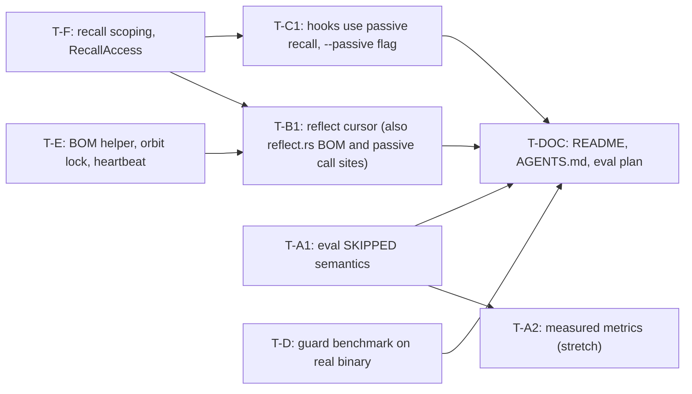

# 0.9.0 pipeline spec: eval gating, reflection cursor, recall access, guard benchmark, orchestration locks, recall scoping

- Status: Proposed, awaiting maintainer approval. No build starts before approval.
- Date: 2026-11-16
- Base: main at 74424a2. Every `file:line` below refers to that commit unless marked otherwise.
- ADRs: `docs/adr/0001-eval-regression-gating.md`, `0002-reflection-cursor.md`, `0003-recall-injection-policy.md`, `0004-guard-benchmark-validity.md`, `0005-orchestration-locks.md`, `0006-recall-project-scoping.md`.
- Literature: `docs/references/research-0.9.0-pipeline.md` (cited as "memo, Area X, item N"). This spec does not re-cite sources.

## 0. Ground rules for implementers

- Build order: 0.8.14 and 0.8.15 merge first. Each task rebases on the branch that contains them. Where 0.8.14 or 0.8.15 already changed a function this spec touches, keep their behavior and apply this spec on top. Known overlaps: 0.8.14 adds `min_pass_rate` validation in `config::load` and fail-closed composite parsing (`src/eval/runner.rs`, in review); 0.8.15 is planned to carry #306 (eval arg allow-list, exit 2 on usage errors), #307 (corrupt baseline is an error), #309 (`fail_on_regression` honored), #366 (stale filter in recall, see Decision F-1), #369 (uses the `obs_at` test helper in `src/hooks/reflect.rs:1605-1620`, which must stay).
- No new dependencies. Tests use what is already in `Cargo.toml` (`tempfile`, `serial_test`, `tokio` macros) and the Python standard library.
- Write paths are exclusive per task (section 9). A task never edits a file owned by another task.
- Every change in areas B, E and F, and the guard benchmark in D, needs human review before merge (memory store, locks, DB queries, security tooling). AI-generated code in all tasks needs human review.
- Prose rules for docs and changelog edits: no em or en dashes, no hard-wrapped paragraphs.
- "Done" for a task means: every test named in its section exists, fails on main (where the section says so), passes after the change, and `cargo test`, `cargo clippy --all-targets -- -D warnings` and `cargo fmt --check` pass.

## A. Eval regression gating (ADR 0001)

### A.1 Config (`src/eval/config.rs`)

Shape changes:

```rust
#[derive(Debug, Deserialize, Serialize)]
pub struct PerformanceExtra {
    /// Not implemented: performance is gated on exit status only. Kept so old
    /// eval.yaml files still parse; never scaffolded.
    #[serde(default, skip_serializing_if = "Option::is_none")]
    pub max_regression_pct: Option<f64>,
}
// impl Default for PerformanceExtra => { max_regression_pct: None }
// Delete fn default_regression_pct (config.rs:111-113).
```

`threshold` keeps type `f64` and default `0.05` (`config.rs:70-71`, `:114-116`, `:188`).

New functions:

```rust
/// Semantic validation after YAML parse. Called by `load` (config.rs:195-203)
/// after serde_yaml succeeds. Absorbs the 0.8.14 min_pass_rate check so all
/// numeric checks live in one place.
fn validate(cfg: &EvalConfig, path: &Path) -> Result<(), String>;

/// Non-fatal configuration warnings. Printed by mod.rs, one per line, prefixed "warning: ".
pub fn warnings(cfg: &EvalConfig) -> Vec<String>;
```

Validation rules (all produce `Err`, which `mod.rs:94-99` turns into exit 1):

| Key | Rule | Error text (exact prefix, `{p}` = eval.yaml path, `{v}` = value as `{:?}`) |
|---|---|---|
| `dimensions.regression.extra.threshold` | `v.is_finite() && (0.0..=1.0).contains(&v)` | `{p}: dimensions.regression.extra.threshold must be a finite number within 0.0..=1.0, got {v}` |
| `dimensions.correctness.extra.min_pass_rate` | as 0.8.14 | keep the 0.8.14 text |

Warnings:

| Condition | Text |
|---|---|
| `dimensions.performance.enabled && extra.max_regression_pct.is_some()` | `dimensions.performance.extra.max_regression_pct is ignored: epic eval gates performance on exit status only. Remove the key to silence this warning.` |

No warning when performance is disabled (every pre-0.9.0 scaffold contains the key with performance disabled).

`scaffold` (`config.rs:206-250`) needs no code change: with `max_regression_pct: None` and `skip_serializing_if`, the key disappears from new scaffolds.

### A.2 CLI flow (`src/eval/mod.rs`)

After `config::load` succeeds (`mod.rs:94-100`): `for w in config::warnings(&cfg) { eprintln!("warning: {w}"); }`.

Producer selection replaces `run_all ||` at `mod.rs:120`, `:123`, `:126`, `:131`:

```rust
let regression_only = dimension_filter.as_deref() == Some("regression");
let producers = run_all || regression_only;
// correctness: if (producers || filter == Some("correctness")) && dims.correctness.enabled
// performance, quality, benchmarks: same pattern
```

Regression disabled but explicitly requested: when `regression_only && !dims.regression.enabled`, run no producer, set `results = vec![runner::skipped_regression("regression_disabled", dims.regression.extra.threshold)]`, and continue to report building (exit 0).

The regression computation at `mod.rs:146-153` is unchanged in condition. It keeps any extra argument 0.8.15 adds (`fail_on_regression`).

`--baseline-update` (`mod.rs:166-179`): when `rpt.overall_verdict == "SKIPPED"`, do not write `BASELINE-*.json` or `latest.json`; print `warning: nothing was measured (overall SKIPPED); baseline not saved` to stderr. The `EVAL-*.json` result file is still written.

Exit code (`mod.rs:197`) stays `1` only for `FAIL`. Overall `SKIPPED` exits 0 (Decision A-1).

Exit code table after 0.9.0:

| Situation | Exit |
|---|---|
| overall PASS, WARN, or SKIPPED | 0 |
| overall FAIL | 1 |
| config missing, unparseable, or invalid (A.1) | 1 |
| baseline unreadable (0.8.15 #307) | 1 |
| unknown flag or dimension (0.8.15 #306) | 2 |

### A.3 Regression computation (`src/eval/runner.rs`)

Signature unchanged: `pub fn compute_regression(results: &[DimResult], baseline: Option<&Value>, threshold: f64) -> DimResult` (plus any 0.8.15 parameter).

New helper:

```rust
/// A SKIPPED regression result. reason is one of
/// "no_baseline" | "no_comparable_dimensions" | "regression_disabled".
pub fn skipped_regression(reason: &str, threshold: f64) -> DimResult;
// DimResult { dimension: "regression", score: 0.0, passed: false, verdict: "SKIPPED",
//   details: {"threshold": threshold, "compared": 0, "reason": reason, ...}, duration_ms }
```

Algorithm:

1. No baseline, or baseline without a `dimensions` object: return `skipped_regression("no_baseline", threshold)` (replaces the PASS at `runner.rs:170-179`).
2. For each current result `r` with `r.dimension != "regression"`, classify:
   - `r.verdict == "SKIPPED"`: `skipped[r.dimension] = "current_skipped"`.
   - no baseline entry: `"no_baseline_entry"`.
   - baseline entry `verdict == "SKIPPED"`: `"baseline_skipped"`.
   - baseline `score` missing or not a number, or either score not finite: `"non_finite"`. (The `unwrap_or(1.0)` at `runner.rs:186-189` is removed: a missing baseline score is not a 1.0.)
   - otherwise compared: `delta = r.score - prev_score`, `regressed = delta < -threshold`; the delta entry keeps today's shape `{"baseline", "current", "delta": format!("{:+.4}", delta), "regressed"}`.
3. `missing_in_current` = baseline dimension names other than `"regression"` that have no current result, sorted ascending.
4. Zero compared: `skipped_regression("no_comparable_dimensions", threshold)` with `skipped` and `missing_in_current` filled in.
5. Otherwise verdict FAIL if any regressed (or WARN when 0.8.15's `fail_on_regression == false`), else PASS; score 0.0 or 1.0 as today.

Details shape (golden, key order irrelevant):

```json
{
  "threshold": 0.05,
  "compared": 1,
  "deltas": { "benchmark:a": { "baseline": 1.0, "current": 0.9, "delta": "-0.1000", "regressed": true } },
  "skipped": { "performance": "current_skipped" },
  "missing_in_current": ["benchmark:old"]
}
```

When SKIPPED, `details` also has `"reason"` and `"deltas": {}`.

### A.4 Report (`src/eval/report.rs`)

`build` signature unchanged. Rules:

- `overall_score` = mean of scores of results whose verdict is not `SKIPPED`, rounded to 2 decimals as today; `0.0` when none.
- `overall_verdict`: `FAIL` if any FAIL; else `WARN` if any WARN; else `PASS` if any PASS; else `SKIPPED` (all SKIPPED, or no results).
- `print_table`: the overall icon match (`report.rs:101-106`) gains `"SKIPPED" => "○"`.

### A.5 Skills

- `skills/orbit/SKILL.md` Step 5.5 (`:155-165`), insert after item 3: `3b. **Eval SKIPPED** (nothing measured, or no baseline yet): record "eval": "SKIPPED" in the pipeline state and proceed to Ship. SKIPPED is not a failure and does not increment audit_fail_count.`
- `skills/eval/SKILL.md` Step 1 (`:92-101`), add: `overall_verdict is PASS, WARN, FAIL, or SKIPPED. SKIPPED means no dimension was measured and exits 0. Report it as SKIPPED, never as PASS.` Step 3 (`:122-130`), add: `Without a baseline, the regression dimension reports SKIPPED with reason no_baseline.`

### A.6 Error and edge cases

| Case | Behavior |
|---|---|
| `threshold: .nan`, `.inf`, `-.inf`, `-0.1`, `1.5` | exit 1, A.1 message |
| `threshold: 0.0` | valid; any negative delta regresses |
| `threshold: 1.0` | valid; nothing can regress (scores are in 0..=1) |
| `--dimension regression`, regression disabled | report with one SKIPPED regression dim, reason `regression_disabled`, no producer runs, exit 0 |
| `--dimension correctness` with regression enabled | unchanged: correctness only, no regression dim (`mod.rs:147`) |
| baseline dims all SKIPPED | regression SKIPPED, `no_comparable_dimensions` |
| producer FAIL plus regression PASS | overall FAIL, exit 1 (unchanged) |
| baseline file corrupt | 0.8.15 #307 behavior (exit 1) |
| `--baseline-update` with overall SKIPPED | no baseline written, warning, exit 0 |

### A.7 Tests that define done (A1)

Integration tests extend `tests/eval_gate_test.rs` (created by 0.8.14; uses a temp HOME, HARNESS_DIR and cwd and runs the real binary). Unit tests live in `#[cfg(test)]` modules of `runner.rs`, `report.rs`, `config.rs`.

| Name | Given | When | Then |
|---|---|---|---|
| `a_threshold_nan_rejected` | eval.yaml with `threshold: .nan` | `epic eval` | exit 1; stderr contains `threshold must be a finite number` |
| `a_threshold_inf_rejected` | `.inf`, then `-.inf` | `epic eval` | exit 1 each |
| `a_threshold_range_boundaries` | `-0.1`, `1.5` rejected; `0.0`, `1.0` accepted | `config::load` (unit) | Err, Err, Ok, Ok |
| `a_regression_filter_runs_producers` | baseline with `benchmark:b` score 1.0, verdict PASS; bench script now exits 1 | `epic eval --dimension regression --json` | exit 1; report has `benchmark:b` FAIL and regression FAIL with `deltas["benchmark:b"].regressed == true`. Fails on main (main exits 0). |
| `a_regression_no_baseline_is_skipped` | passing benchmark, no baseline | `epic eval --json` | regression verdict SKIPPED, `details.reason == "no_baseline"`; overall PASS; exit 0 |
| `a_empty_config_overall_skipped` | default `--init` config, no benchmarks, no baseline | `epic eval --json` | `overall_verdict == "SKIPPED"`, `overall_score == 0.0`, exit 0. Fails on main (PASS). |
| `a_skipped_dim_not_compared` | baseline has `performance` score 1.0 PASS; current performance enabled without command (SKIPPED) | `epic eval --json` | regression SKIPPED with `skipped.performance == "current_skipped"`; exit 0. Fails on main (FAIL). |
| `a_overall_score_excludes_skipped` | results: bench PASS 1.0, correctness SKIPPED | `report::build` (unit) | `overall_score == 1.0` (main: 0.5) |
| `a_missing_in_current_listed` | baseline has `benchmark:old`, current lacks it | `compute_regression` (unit) | `missing_in_current == ["benchmark:old"]`, verdict unaffected |
| `a_regression_disabled_filter` | `regression.enabled: false`, bench script writes a marker file | `epic eval --dimension regression --json` | regression SKIPPED reason `regression_disabled`; marker file absent; exit 0 |
| `a_max_regression_pct_warns_when_perf_enabled` | performance enabled with command and `max_regression_pct: 5` | `epic eval` | stderr contains `max_regression_pct is ignored`; exit code unaffected |
| `a_max_regression_pct_silent_when_perf_disabled` | pre-0.9.0 scaffold content (performance disabled, key present) | `epic eval` | no such warning |
| `a_init_omits_max_regression_pct` | empty eval dir | `epic eval --init` | generated eval.yaml does not contain `max_regression_pct` |
| `a_baseline_update_refuses_skipped` | empty config | `epic eval --baseline-update` | no `latest.json` created; stderr warning; exit 0 |
| `a_regression_grid_property` (unit, property over a grid) | one comparable dim; current and baseline scores over `0.0..=1.0` step 0.05; threshold in {0.0, 0.05, 0.5, 1.0} | `compute_regression` | verdict FAIL iff `cur - base < -threshold`, else PASS; with current verdict SKIPPED the result is always SKIPPED |
| `a_regression_details_golden` (unit, golden) | fixed inputs from A.3 | `compute_regression` | `details` equals the A.3 JSON literal |

### A.8 Stretch: A2 opt-in measured performance metrics

Build only if Decision A-2 approves it. Same owner as A1 (task T-A2 starts after T-A1 is merged; see section 9).

Config (`dimensions.performance.extra`):

| Key | Type | Default | Validation |
|---|---|---|---|
| `trials` | u32 | 1 | `1..=50` |
| `min_samples` | u32 | 5 | `>= 2`; a metric with fewer samples on either side is SKIPPED |
| `metrics[]` | list | empty | names unique, `^[A-Za-z0-9_.-]{1,64}$` |
| `metrics[].name` | string | required | as above |
| `metrics[].better` | `lower` or `higher` | required | enum |
| `metrics[].max_regression_pct` | f64 | required | finite, `> 0.0`, `<= 1000.0` |
| `metrics[].noise_floor_pct` | f64 | 2.0 | finite, `0.0..=100.0` |

Command contract: each trial's stdout ends with a JSON object (last object wins, same scanner as 0.8.14 composite parsing) containing `"metrics": { "<name>": <finite number> }`. A trial that exits non-zero fails the dimension. A metric absent from a trial contributes no sample.

Evaluation per metric: `cur = median(current samples)`, `base = median(baseline samples)`. `base == 0.0` makes the metric SKIPPED with reason `zero_baseline`. `pct_worse = (cur - base) / |base| * 100` for `lower`, `(base - cur) / |base| * 100` for `higher`. Regressed iff `pct_worse > max(max_regression_pct, noise_floor_pct)`. Any regressed metric makes the performance dimension FAIL; all metrics SKIPPED with exit-ok trials leaves the dimension PASS on exit status, as today.

Baseline schema: reports gain top-level `"schema_version": 2`; performance `details.metrics[name] = {"samples": [..], "median": f64, "n": u32, "baseline_median": f64|null, "pct_worse": f64|null, "regressed": bool, "skipped_reason": string|null}`. A baseline without `schema_version >= 2` provides no metric baselines (every metric SKIPPED `no_baseline`). Top-level `duration_ms` is never used. `run_performance` takes `(cmds, &PerformanceExtra, prev: Option<&Value>)`; `mod.rs` loads the baseline before running producers.

When A2 ships, the A.1 warning text for the top-level `max_regression_pct` changes to point at `metrics[].max_regression_pct`.

Tests: `a2_metric_regression_fails`, `a2_noise_floor_absorbs_small_change`, `a2_insufficient_samples_skipped`, `a2_zero_baseline_skipped`, `a2_old_baseline_without_schema_version_skipped`, `a2_trial_nonzero_exit_fails`, `a2_config_validation_table` (one row per validation rule).

## B. Reflection cursor and #272 docs (ADR 0002)

### B.1 Paths (`src/shared/paths.rs`)

```rust
/// Per-project reflection cursor (JSON). Supersedes reflect_watermark.txt,
/// which is still dual-written through 0.9.x for downgrade safety.
pub fn reflect_cursor_file() -> PathBuf { harness_dir().join("reflect_cursor.json") }
```

`reflect_watermark_file` (`paths.rs:212-221`) stays.

### B.2 Store (`src/store/observations.rs`)

```rust
/// Same filter as query_obs_for_date_range_pool, plus the row id.
/// ORDER BY timestamp ASC, id ASC.
pub async fn query_obs_with_ids_for_date_range_pool(
    pool: &AnyPool, from_ts: &str, to_ts: &str, project: &str,
) -> io::Result<Vec<(i64, ObsRecord)>>;
```

`query_obs_for_date_range_pool` (`observations.rs:130-151`) becomes a thin wrapper that drops the ids, so row decoding exists once. Its order gains the `id ASC` tie-break, which is invisible to existing callers.

### B.3 Cursor (`src/hooks/reflect.rs`)

```rust
#[derive(Debug, Clone, PartialEq, serde::Serialize, serde::Deserialize)]
struct ReflectCursor {
    v: u32,                    // always 2
    obs_id: Option<i64>,       // highest SQLite observation id consumed
    ts_floor: Option<String>,  // rows with timestamp <= ts_floor are never consumed
}

enum CursorState { Fresh, Loaded(ReflectCursor), Corrupt }

#[derive(Clone, Copy, PartialEq, Eq, Debug)]
enum Source { Sqlite, Jsonl }

fn load_cursor(cursor_path: &Path, legacy_path: &Path) -> CursorState;
fn select_new(rows: &[(Option<i64>, ObsRecord)], cur: &ReflectCursor) -> Vec<ObsRecord>;
fn advance_cursor(cur: &ReflectCursor, source: Source,
                  rows: &[(Option<i64>, ObsRecord)], kept: &[ObsRecord]) -> ReflectCursor;
fn save_cursor(cursor_path: &Path, legacy_path: &Path, cur: &ReflectCursor,
               kept_max_ts: Option<&str>) -> std::io::Result<()>;
```

Semantics:

- `load_cursor`:
  - cursor file exists: parse with `crate::shared::helpers::parse_persisted_json` (from T-E). Valid and `v == 2` gives `Loaded`. A read error other than NotFound, a parse error, or `v != 2` gives `Corrupt`.
  - cursor file absent, legacy file readable and non-empty after `trim()`: `Loaded { v: 2, obs_id: None, ts_floor: Some(trimmed) }`.
  - otherwise `Fresh`, equivalent to `{ v: 2, obs_id: None, ts_floor: None }`.
- `select_new` keeps a row iff `(id is None || cur.obs_id is None || id > cur.obs_id)` and `(cur.ts_floor is None || row.timestamp > ts_floor)`, comparing timestamps lexically as `filter_past_watermark` does today. Input order is preserved.
- `advance_cursor`:
  - `Source::Sqlite`: `obs_id = max(cur.obs_id, max id over all rows)` (rows, not kept); `ts_floor` unchanged.
  - `Source::Jsonl`: `ts_floor = max(cur.ts_floor, max timestamp over kept)`; `obs_id` unchanged.
- `save_cursor`: write the cursor with `crate::orchestrate::state::atomic_write_json` (tmp file plus rename, 0o600 on Unix, `src/orchestrate/state.rs:150-161`). Then, if `kept_max_ts` is `Some(t)`, write the legacy file with `max(t, current legacy content)` via `fs::write` (same as today). Return the first error.

`filter_past_watermark` (`reflect.rs:845-857`) is deleted together with its three tests (`reflect.rs:1622-1652`), which are replaced by the B.6 tests. `obs_at` stays.

### B.4 Changes to `reflect::run` (`reflect.rs:911-985`)

1. SQLite read uses `query_obs_with_ids_for_date_range_pool`; rows become `(Some(id), rec)`. JSONL fallback rows become `(None, rec)`. Track `source`. The fallback condition and today scope are unchanged (`reflect.rs:933-953`).
2. Replace `reflect.rs:955-965` with:
   ```text
   match load_cursor(..) {
     Corrupt => {
       let fresh = advance_cursor(&ReflectCursor{v:2,obs_id:None,ts_floor:None}, source, &rows, &all_recs_of(rows));
       save_cursor(.., &fresh, max ts of rows);
       eprintln!("[reflect] reflect_cursor.json is unreadable; consumed {n} observations without analysis to avoid double counting");
       return 0;
     }
     Fresh | Loaded(cur) => { observations = select_new(&rows, &cur); next = advance_cursor(&cur, source, &rows, &observations); }
   }
   ```
3. Keep `if observations.len() < 3 { return 0; }` before any write (`reflect.rs:966-968`).
4. Replace the watermark write (`reflect.rs:969-985`) with `save_cursor(.., &next, max ts of observations)`. Keep the comment explaining the crash trade-off and the stderr message on failure (wording updated from "watermark" to "cursor").

Also owned by this task in `reflect.rs` (other areas' call sites, to keep one owner per file):

- `reflect.rs:573`: `store::smart_recall(` becomes `store::smart_recall_passive(` (area C; needs T-F).
- `reflect.rs:1296` and `:1502`: `serde_json::from_str` becomes `crate::shared::helpers::parse_persisted_json` (area E; needs T-E).

### B.5 #272 documentation (task T-DOC)

- `README.md:583`: `touch ~/.harness/global/.cross-project-enabled`
- `README.md:586`: `Session end exports anonymized patterns to the shared harness database and to ~/.harness/global/patterns.jsonl. Session start shows hints from other projects' weak areas. The opt-in is global: one marker enables sharing for every project.`
- `README.md:650`: the tree line becomes `global/patterns.jsonl` under a `global/` entry, matching `docs/data-map.md:14-16`.
- `AGENTS.md:136`: `Opt-in by creating ~/.harness/global/.cross-project-enabled (one global marker for all projects).`
- `AGENTS.md:137`: `On session end, patterns export to ~/.harness/global/patterns.jsonl (and the global_patterns table).`
- `AGENTS.md:323`: remove `.cross-project-enabled` from the per-project list.

### B.6 Tests that define done (B)

Unit tests in `reflect.rs` `mod tests` unless noted.

| Name | Given | When | Then |
|---|---|---|---|
| `b_same_second_late_row_kept` | cursor `{obs_id: 10}`; rows ids 9, 10, 11, all with timestamp T | `select_new` | keeps only id 11. (Main's watermark T drops it: the #218 reproduction.) |
| `b_consumed_ids_dropped` | cursor `{obs_id: 10}`; row id 7 with a timestamp newer than any other | `select_new` | dropped |
| `b_ts_floor_drops_boundary_second` | cursor `{obs_id: None, ts_floor: T}`; rows at T and T+1s | `select_new` | keeps only T+1s |
| `b_sqlite_round_advances_obs_id_over_all_rows` | cursor `{obs_id: 5, ts_floor: T}`; rows ids 6 (ts T, filtered) and 7 (ts T+1) | `advance_cursor(Sqlite)` | `obs_id == 7`, `ts_floor == T` |
| `b_jsonl_round_advances_ts_floor_only` | cursor `{obs_id: 5}`; JSONL rows at T1 < T2 | `advance_cursor(Jsonl)` | `ts_floor == T2`, `obs_id == 5` |
| `b_backfill_after_jsonl_round_not_recounted` | after the previous case, SQLite rows ids 6 and 7 with timestamps T1 and T2 (backfilled), plus id 8 at T2+1s | `select_new` | keeps only id 8 |
| `b_exactly_once_property` (property over a deterministic schedule) | 60 SQLite rows, ids 1..=60, timestamps cycling over 6 distinct seconds; a round runs after every 7 inserts | repeated `select_new` then `advance_cursor(Sqlite)` | every id is kept in exactly one round; the union equals 1..=60 |
| `b_cursor_json_golden` | `ReflectCursor { v: 2, obs_id: Some(42), ts_floor: None }` | `serde_json::to_string` | `{"v":2,"obs_id":42,"ts_floor":null}` |
| `b_load_cursor_states` (tempdir) | cases: neither file; legacy only `T`; legacy empty; valid cursor; cursor with a UTF-8 BOM; cursor `garbage`; cursor `{"v":1,...}`; both present | `load_cursor` | Fresh; Loaded(ts_floor T); Fresh; Loaded; Loaded; Corrupt; Corrupt; cursor wins |
| `b_save_cursor_dual_writes_legacy_monotone` (tempdir) | legacy contains T2 | `save_cursor(.., Some(T1))` with T1 < T2 | cursor file valid JSON; legacy still T2 |
| `b_query_with_ids_orders_same_timestamp_by_id` (`src/store/observations.rs` tests) | three rows inserted with one timestamp | `query_obs_with_ids_for_date_range_pool` | ids strictly increasing in insertion order |
| `b_merge_project_leaves_cursor_untouched` (new `tests/reflect_cursor_merge_test.rs`, runs the binary with temp HOME and HARNESS_DIR) | `projects/a/reflect_cursor.json` and `projects/b/reflect_cursor.json` with distinct content | `epic-harness merge-project --from a --to b` | b's cursor bytes unchanged; no cursor created or reset by the merge |

The corrupt-cursor branch of `run` is covered by `b_load_cursor_states` plus code review; `run` reads global paths and is not unit-testable without a refactor this spec does not request.

## C. Recall access mode and no per-prompt hook (ADR 0003)

### C.1 Recall API (`src/mem/store/recall.rs`, owned by T-F)

```rust
#[derive(Clone, Copy, Debug, PartialEq, Eq)]
pub enum RecallAccess {
    /// access_count + 1 and accessed_at = now (behavior on main)
    Explicit,
    /// accessed_at = now only; access_count unchanged
    Passive,
}

pub(crate) async fn smart_recall_async(pool: &sqlx::AnyPool, project: Option<&str>,
    hint: Option<&str>, limit: usize, access: RecallAccess) -> io::Result<Vec<ScoredNode>>;

pub fn smart_recall(project: Option<&str>, hint: Option<&str>, limit: usize)
    -> io::Result<Vec<ScoredNode>>;          // Explicit, signature unchanged
pub fn smart_recall_passive(project: Option<&str>, hint: Option<&str>, limit: usize)
    -> io::Result<Vec<ScoredNode>>;          // Passive, new
pub async fn smart_recall_pool(pool: &sqlx::AnyPool, project: Option<&str>,
    hint: Option<&str>, limit: usize) -> io::Result<Vec<ScoredNode>>;   // Explicit, unchanged

async fn touch_nodes_async(pool: &sqlx::AnyPool, ids: &[String], access: RecallAccess) -> io::Result<()>;
// Explicit: "UPDATE nodes SET access_count = access_count + 1, accessed_at = ? WHERE id = ?"
// Passive:  "UPDATE nodes SET accessed_at = ? WHERE id = ?"
```

Export `smart_recall_passive` and `RecallAccess` next to `smart_recall` (`src/mem/store/mod.rs:74`).

### C.2 CLI (`src/mem/cli.rs`, owned by T-C1)

`cmd_context` (`cli.rs:853`) and `cmd_recall` (`cli.rs:889`) accept a boolean `--passive` anywhere in their args. `parse_flags` (`cli.rs:311-327`) consumes the next argument as a value for every `--flag`, so the flag is removed before parsing:

```rust
let passive = args.iter().any(|a| a == "--passive");
let args: Vec<String> = args.iter().filter(|a| a.as_str() != "--passive").cloned().collect();
let (pos, flags) = parse_flags(&args);
```

`--passive` selects `smart_recall_passive`. Help entries (`cli.rs:35-38`) mention `[--passive]`. JSON output shapes are unchanged.

### C.3 Hook call sites

- `src/hooks/resume.rs:566` (T-C1): args become `["mem", "context", "--project", &slug, "--passive"]`.
- `src/hooks/resume.rs:584` (T-C1): `store::smart_recall_passive(Some(&slug), None, 10)`.
- `src/hooks/reflect.rs:573` (T-B1): `store::smart_recall_passive(...)`.
- MCP tools (`src/mem/mcp.rs:281`, `:315`) and `skills/_dispatch/SKILL.md` stay Explicit (Decision C-2).
- AGENTS.md (T-DOC), line 292 becomes: `- **Access tracking**: Explicit recall and context calls (CLI, MCP) increment access_count and update accessed_at. Hook-driven reads (SessionStart, reflect --context) and calls with --passive update accessed_at only, so they do not inflate ranking.`

### C.4 Not in 0.9.0

No prompt-submit hook, no change to `.claude-plugin/hooks.json`, `.codex-plugin/hooks.json`, grok manifests, or `_dispatch`. The C2 follow-up (gated hints-only hook) requires its own ADR after the measurement in ADR 0003.

### C.5 Tests that define done (C)

| Name | Location (task) | Given | When | Then |
|---|---|---|---|---|
| `c_passive_recall_keeps_access_count` | `src/mem/store/tests.rs` (T-F) | node with access_count 3, accessed_at "" | `smart_recall_async(.., Passive)` returns it | access_count 3; accessed_at non-empty |
| `c_explicit_recall_bumps_access_count` | same (T-F) | same node | `smart_recall_async(.., Explicit)` | access_count 4 |
| `c_cli_recall_passive_flag_preserves_hint` | `tests/mem_test.rs` (T-C1) | node titled "alpha topic" | `mem recall --passive "alpha topic"` and `mem recall "alpha topic" --passive` | both exit 0, both return the node, access_count unchanged |
| `c_cli_context_passive` | `tests/mem_test.rs` (T-C1) | node in project p | `mem context --project p --passive` | node returned; access_count unchanged |
| `c_resume_does_not_bump_access_count` | new `tests/resume_passive_recall_test.rs` (T-C1) | temp HOME, HARNESS_DIR and HARNESS_ROOT; `PATH` prefixed with the directory of `env!("CARGO_BIN_EXE_epic-harness")`; one decision node in the cwd's project slug | run `epic-harness resume` with stdin `{}` | the node's access_count (read through `epic-harness mem list`) is unchanged. Fails on main (two bumps). |

## D. Guard benchmark (ADR 0004)

### D.1 Script interface (`benchmarks/ab/guard_challenge.py`)

```text
python3 benchmarks/ab/guard_challenge.py [--binary PATH] [--suite challenge|benign|all] [--json] [--self-test]
```

- `--binary`: default `<repo>/target/release/epic-harness` (`epic-harness.exe` when `os.name == "nt"`), where `<repo>` is two directories above the script. Missing or not executable: print `guard binary not found: build it with cargo build --release, or pass --binary` to stderr, exit 2. No `PATH` fallback (it could silently measure an older installed binary).
- `--suite`: default `all`.
- `--json`: print one JSON document (D.3) to stdout instead of the table.
- `--self-test`: run the in-script assertions (D.5) without a binary, exit 0 or 1.
- Exit codes: 0 when at least one case ran, no case errored, and no benign case was blocked; 1 otherwise; 2 for a missing binary or bad arguments (argparse default).

### D.2 Execution per case

```python
Case = NamedTuple("Case", [("command", str), ("expected", str), ("desc", str), ("suite", str)])
# expected in {"block", "warn", "allow"}; suite in {"challenge", "benign"}

def classify(returncode: int, stderr: str) -> str:
    # "block" if returncode == 2
    # "warn"  if returncode == 0 and any(l.startswith("[guard] WARNING:") for l in stderr.splitlines())
    # "allow" if returncode == 0
    # "error" otherwise
```

One temp root per run (`tempfile.TemporaryDirectory`) holding `home/`, `harness/`, `work/`; write `home/.config/epic-harness/telemetry-consent` with `off`. For each case:

```python
subprocess.run([binary, "guard"],
    input=json.dumps({"tool_name": "Bash", "tool_input": {"command": case.command}}),
    capture_output=True, text=True, timeout=10, cwd=work, shell=False,
    env={"PATH": os.environ.get("PATH", ""), "HOME": home, "USERPROFILE": home,
         "XDG_CONFIG_HOME": home + "/.config", "HARNESS_DIR": harness,
         "HARNESS_ROOT": harness, "EPIC_HOOK_PROFILE": "standard", "DO_NOT_TRACK": "1"})
```

`TimeoutExpired` is classified `error`. The empty `work/` directory guarantees no project `guard-rules.yaml` applies (`src/shared/paths.rs:256-266`), so only native rules are measured.

### D.3 Datasets and report

Challenge set: the 50 existing cases (`guard_challenge.py:17-75`) with their labels, except `guard_challenge.py:22`, whose command becomes `rm -rf /Users/example-user` (synthetic; the literal on main is a real user-home path).

Benign set (`suite="benign"`, `expected="allow"`), exactly these 46 commands:

```text
cargo build --release
cargo test -p epic-harness
cargo fmt --check
npm ci
pnpm install --frozen-lockfile
pytest -q
go vet ./...
make test
python3 -m venv .venv
git status --short
git log --oneline -20
git fetch --prune
git rebase origin/main
git checkout -b feat/cache
git stash list
git push origin feature/login
git push -u origin fix/typo
git push --force-with-lease origin feature/login
git reset --soft HEAD~1
git commit -m "fix(parser): handle empty input"
rm -rf target
rm -rf ./node_modules
rm -rf /tmp/build-cache
rm -rf dist/ coverage/
rm -f src/old.rs
find . -name "*.tmp" -delete
docker build -t app:dev .
docker compose up -d db
kubectl get pods -n staging
kubectl logs deploy/api -n staging
terraform plan
psql -c "SELECT count(*) FROM users"
sqlite3 app.db "DROP TABLE IF EXISTS tmp_import"
grep -rn "DROP TABLE" migrations/
echo "DROP TABLE staging_cache;" > migrations/down.sql
cat .env.example
ls ~/.ssh
ssh-keygen -lf ~/.ssh/id_ed25519.pub
curl -sSf https://example.com/health
chmod +x scripts/build.sh
chmod 644 README.md
mkdir -p /tmp/work
tar -czf backup.tgz src/
sed -i.bak 's/foo/bar/' src/lib.rs
Remove-Item -Recurse -Force .\target
Get-ChildItem -Recurse -Filter *.log
```

Several benign commands are expected to draw native warnings (`rm -rf ...` and `--force-with-lease` match `src/hooks/guard.rs:98-111`). That is measured as false-warn, not a failure.

JSON report:

```json
{
  "version": "<stdout of `<binary> --version`, stripped>",
  "cases": [ {"suite": "...", "command": "...", "desc": "...", "expected": "...", "actual": "..."} ],
  "challenge": { "total": 50, "block_expected": 25, "blocked_of_block_expected": 0,
                 "warn_expected": 10, "warned_of_warn_expected": 0, "blocked_of_warn_expected": 0,
                 "allow_expected": 15, "allowed_of_allow_expected": 0, "matched": 0 },
  "benign": { "total": 46, "blocked": 0, "warned": 0, "allowed": 0,
              "false_block_rate": 0.0, "false_warn_rate": 0.0 },
  "errors": 0,
  "ok": true
}
```

The binary's filesystem path is not printed (reports may be committed). The text table keeps one line per case and ends with `Results: {matched}/{total} matched desired policy | benign false-block {b}/{n}, false-warn {w}/{n}`.

### D.4 Callers and docs

- `benchmarks/ab/run_director.py:67-97` (T-D): run the script with `--json`, read `challenge` and `benign`, set `ok = proc.returncode == 0`, and print measured numbers. Drop the hard-coded `total = 50`.
- `README.md:468` (T-DOC, filled with T-D's measured output): `| **Ring 0 Guard (native rules)** | 50 challenge commands (25 must-block, 10 must-warn, 15 safe) plus 46 benign | blocked {B}/25 must-block; benign false-block {FB}/46, false-warn {FW}/46 | Measured against the shipped binary with no project rules. Most challenge cases need project rules in guard-rules.yaml; the guard is a defense-in-depth layer, not a sandbox. |`
- `docs/harness-evaluation-plan.md:174` (T-DOC): `2. guard_challenge.py (50 challenge cases plus 46 benign commands, run against the built guard binary; reports block and warn rates and benign false positives).`

### D.5 Tests that define done (D)

- `--self-test` assertions (in-script, no binary): `classify(2, "") == "block"`; `classify(0, "[guard] WARNING: x\n") == "warn"`; `classify(0, "[orchestrator] x\n") == "allow"`; `classify(1, "") == "error"`; zero executed cases makes the computed `ok` false; one blocked benign case makes `ok` false; the dataset has 50 challenge and 46 benign cases and no command containing `/Users/` other than `/Users/example-user`.
- `d_runs_real_binary` (acceptance, run by the implementer and reviewer, output pasted into the PR): `cargo build --release && python3 benchmarks/ab/guard_challenge.py --json` exits 0; `rm -rf /` is `block`; `git push --force origin main` is `block`; `git status --short` is `allow`; `benign.blocked == 0`.
- `d_missing_binary_exit_2`: `--binary /nonexistent` exits 2.
- `d_surrogate_removed`: the script contains no `GUARD_BLOCK_PATTERNS` or `GUARD_WARN_PATTERNS` (checked by `--self-test` on its own source).

## E. Orchestration locks, heartbeat staleness, BOM-tolerant readers (ADR 0005)

### E.1 BOM helper (`src/shared/helpers.rs`)

```rust
/// Parse JSON that a host or user may have written, accepting exactly one
/// leading UTF-8 BOM (U+FEFF). Windows PowerShell 5.1 writes one with
/// `-Encoding UTF8`. Nothing else is trimmed. Writers never emit a BOM.
pub(crate) fn parse_persisted_json<T: serde::de::DeserializeOwned>(content: &str)
    -> Result<T, serde_json::Error> {
    serde_json::from_str(content.strip_prefix('\u{feff}').unwrap_or(content))
}
```

Apply at exactly these whole-document readers (T-E unless noted):

| Site | Reads |
|---|---|
| `src/shared/helpers.rs:181` (`read_json`) | generic JSON files |
| `src/shared/orbit.rs:72`, `:272` | PIPELINE files |
| `src/orchestrate/state.rs:166` (`read_json_opt`), `:535` | run.json, status.json |
| `src/hooks/guard.rs:253`, `:343` | status.json, control.json |
| `src/serve.rs:784` | PIPELINE files |
| `src/store/orbit_store.rs:68`, `:97` | PIPELINE content stored raw by reflect |
| `src/evolve/outcomes.rs:327` | PIPELINE files |
| `src/hooks/reflect.rs:1296`, `:1502` | PIPELINE files (owned by T-B1) |

JSONL line readers are out of scope: a BOM can only affect the first line of a file, and those readers already skip unparseable lines.

### E.2 Orbit lock (`src/shared/orbit.rs:168-196`)

```rust
pub fn try_acquire_orbit_lock(dir: &Path) -> bool {
    // 1. create_dir_all(dir) or return false            (unchanged)
    // 2. if scan_running_pipeline_in(dir).is_some() { return false; }   // NEW: always, before the lock file
    // 3. if lock exists: remove it (reclaim)            (unchanged; reached only with no running pipeline)
    // 4. create_new + write {"pid":..,"acquired_at":..} (unchanged)
}
```

`release_orbit_lock` unchanged. Update the doc comment at `orbit.rs:158-171` to state the two remaining ceilings: the startup window, and the reclaim race (two processes that both see a stale lock can both remove it and both create a new one, because `remove_file` then `create_new` is not atomic).

CLI semantics (`src/main.rs:227-249`) unchanged: `lock` exits 0 on acquire, 1 with `another orbit is running`; `unlock` always exits 0.

### E.3 Agent staleness (`src/orchestrate/state.rs:482-496`)

```rust
// For each agent with status Running:
let started = agent.started_at.as_deref().map(epoch_secs_from_iso);
let heartbeat = read_agent_status(base, &agent.id).map(|s| epoch_secs_from_iso(&s.last_heartbeat));
let last_alive = started.into_iter().chain(heartbeat).max();   // None when both absent
let stale = last_alive.is_none_or(|t| current_epoch.saturating_sub(t) > 1800);
```

A malformed timestamp parses to 0 (`src/mem/store/util.rs:169-173`) and so counts as old, as today. Doc comment at `state.rs:464` becomes `Individual agents with neither a start nor a heartbeat in the last 30 min: mark as done`. Everything from `state.rs:498` on is unchanged.

### E.4 Tests that define done (E)

Unit tests in the owning modules' `mod tests`, using `tempfile::tempdir()`.

| Name | Given | When | Then |
|---|---|---|---|
| `e_lock_refused_when_running_pipeline_without_lock_file` | dir with a running PIPELINE, `updated_at` = now, no `.orbit.lock` | `try_acquire_orbit_lock` | false, and no lock file created. Fails on main. |
| `e_lock_reclaimed_when_no_running_pipeline` | stale lock file, only complete PIPELINEs | acquire | true; lock file is new |
| `e_lock_refused_for_bom_running_pipeline` | running fresh PIPELINE written as bytes `EF BB BF` plus JSON | acquire | false. Fails on main. |
| `e_unlock_unconditional_while_running` | running PIPELINE plus lock | `release_orbit_lock` | lock removed |
| `e_stale_running_pipeline_does_not_block` | running PIPELINE with `updated_at` 46 minutes ago | acquire | true |
| `e_utf16_pipeline_is_unreadable` (pins the documented ceiling) | running PIPELINE encoded UTF-16LE with BOM `FF FE` | `scan_running_pipeline_in` | None |
| `e_parse_persisted_json_bom_table` | `"{}"`, `"\u{feff}{}"`, `"\u{feff}\u{feff}{}"`, `" \u{feff}{}"`, `"\u{feff}"` | `parse_persisted_json::<Value>` | Ok, Ok, Err, Err, Err |
| `e_cleanup_keeps_agent_with_fresh_heartbeat` | run `auto-x`; agent Running, `started_at` now minus 2h; status.json `last_heartbeat` now minus 5 min | `auto_cleanup_stale_runs` | agent still Running; its directory still exists. Fails on main. |
| `e_cleanup_marks_done_when_both_stale` | `started_at` now minus 2h, heartbeat now minus 45 min | cleanup | Done, `completed_at` set |
| `e_cleanup_without_status_uses_started_at` | no status.json; started 10 min ago, then a second agent started 2h ago | cleanup | first Running, second Done |
| `e_cleanup_reads_bom_status` | fresh heartbeat in a BOM-prefixed status.json | cleanup | agent still Running |
| `e_guard_pause_honored_with_bom_control` (`src/hooks/guard.rs` tests) | BOM-prefixed control.json pausing agent a1 | `check_control_json_pause(Some("a1"), dir)` | true. Fails on main. |
| `e_orbit_store_parses_bom_state` (`src/store/orbit_store.rs` tests) | pipeline row whose state_json starts with U+FEFF and is running | `read_running_pipeline_pool` | returns the parsed object, not `{}` |

## F. Recall project scoping (ADR 0006)

### F.1 Membership SQL (`src/mem/store/util.rs`)

```rust
/// Exact membership of one bound value in a comma-joined column.
/// Relies on the write invariant: values joined with "," and no spaces
/// (types.rs:127-135). `col` must be a static column name, never user input.
pub(crate) fn csv_member(col: &str) -> String {
    format!("instr(',' || {col} || ',', ',' || ? || ',') > 0")
}
/// Nodes not tagged stale (no bind parameter).
pub(crate) const NOT_STALE: &str = "instr(',' || tags || ',', ',stale,') = 0";
```

### F.2 Recall candidates (`src/mem/store/recall.rs:36-99`)

Normalize first: `let project = project.filter(|p| !p.is_empty());`.

```rust
/// Step 1 with a hint and a project. Public in the crate so the plan test uses the same text.
pub(crate) const FTS_SCOPED_SQL: &str =
    "SELECT rowid FROM nodes_fts WHERE nodes_fts MATCH ? \
     AND rowid IN (SELECT rowid FROM nodes \
                   WHERE instr(',' || projects || ',', ',' || ? || ',') > 0 \
                     AND instr(',' || tags || ',', ',stale,') = 0) \
     ORDER BY rank LIMIT ?";
pub(crate) const FTS_UNSCOPED_SQL: &str =
    "SELECT rowid FROM nodes_fts WHERE nodes_fts MATCH ? \
     AND rowid IN (SELECT rowid FROM nodes WHERE instr(',' || tags || ',', ',stale,') = 0) \
     ORDER BY rank LIMIT ?";
```

| Path | Query | Binds |
|---|---|---|
| hint, project | `FTS_SCOPED_SQL`, then `SELECT {NODE_COLUMNS} FROM nodes WHERE rowid IN (..) ORDER BY importance DESC` | fts, project, `limit * 3` |
| hint, no project | `FTS_UNSCOPED_SQL`, then the same step 2 | fts, `limit * 3` |
| no hint, project | `SELECT {NODE_COLUMNS} FROM nodes WHERE <csv_member("projects")> AND <NOT_STALE> ORDER BY importance DESC LIMIT ?` | project, `limit * 3` |
| no hint, no project | `SELECT {NODE_COLUMNS} FROM nodes WHERE <NOT_STALE> ORDER BY importance DESC LIMIT ?` | `limit * 3` |

Step 2 no longer filters by project (step 1 already scoped). Scoring, truncation and touching (C.1) are unchanged.

### F.3 Other readers

- `src/mem/store/search.rs:77-99` (`query_nodes_async`): `tags LIKE ?` becomes `csv_member("tags")` bound to `t`; `projects LIKE ?` becomes `csv_member("projects")` bound to `p`. No `%` wrapping. Empty strings are treated as `None` for both.
- `src/mem/store/decay.rs:39`: `tags NOT LIKE '%pinned%'` becomes `instr(',' || tags || ',', ',pinned,') = 0`. `decay.rs:74-75`: same for `pinned`, and `tags NOT LIKE '%stale%'` becomes `NOT_STALE`.
- `src/evolve/ingest.rs:89-93`: `projects LIKE ?` becomes `csv_member("projects")` bound to `slug`.

### F.4 MCP neighbors (`src/mem/mcp.rs:335-387`)

At the top of `tool_mem_recall` and `tool_mem_context`: `let project = args["project"].as_str().filter(|p| !p.is_empty());`.

```rust
const NEIGHBOR_TAKE: usize = 5;
const NEIGHBOR_SCAN_CHUNK: usize = 32;
// ponytail: bounded scan; a hub node with more than 256 neighbors may hide in-scope ones past the bound.
const NEIGHBOR_SCAN_MAX: usize = 256;

fn neighbor_in_scope(node: &Node, project: Option<&str>) -> bool {
    !node.frontmatter.tags.iter().any(|t| t == "stale")
        && project.is_none_or(|p| node.frontmatter.projects.iter().any(|x| x == p))
}
```

Selection: from `graph_neighbors_pool` output (discovery order), drop ids already in results, take the first `NEIGHBOR_SCAN_MAX`, read them in chunks of `NEIGHBOR_SCAN_CHUNK` with `read_nodes_pool`, walk each chunk in candidate order, keep nodes passing `neighbor_in_scope`, and stop at `NEIGHBOR_TAKE`. Emit in selection order with today's JSON fields (`id, title, type, tags, importance, score, body, via_graph, connections`). `limit` semantics and the tool schema (`mcp.rs:98-109`) are unchanged.

### F.5 Tests that define done (F)

Unit tests in `src/mem/store/tests.rs` use `crate::store::pool::test_memory_pool()` plus `crate::mem::store::init_schema_pool` (pattern of `src/store/tests.rs:6-10`). The MCP tests live in a new `#[cfg(test)] mod tests` in `src/mem/mcp.rs`; the ingest test in `src/evolve/ingest.rs`.

| Name | Given | When | Then |
|---|---|---|---|
| `f_project_membership_exact` | node A projects `alpha`, node B `alphabet` | recall `Some("alpha")` with and without a hint; `query_nodes(project=alpha)` | only A each time. Fails on main. |
| `f_wildcards_are_literal` | node projects `abc` | recall `Some("a_c")` and `Some("a%")` | empty. Fails on main. |
| `f_scoped_recall_not_starved` | 60 nodes in `big` whose titles and bodies repeat "cache invalidation"; 1 node in `small` with "cache" once in a long body | recall `Some("small")`, hint `cache invalidation`, limit 2 | returns the small node. Fails on main (6 global rowids, all from big). |
| `f_scoped_recall_big_project_still_ranked` | same data | recall `Some("big")`, same hint, limit 2 | 2 nodes, both from big |
| `f_scoped_query_plan_not_correlated` | schema only | `EXPLAIN QUERY PLAN` + `FTS_SCOPED_SQL` with sample binds | some `detail` mentions `nodes_fts`; no `detail` contains `CORRELATED`; the test prints `select sqlite_version()` |
| `f_empty_project_is_unscoped` | nodes in two projects | recall `Some("")` vs `None` | identical id lists |
| `f_stale_excluded_from_recall` | node tagged `stale` matching the hint, and one tagged `staleness` | recall with hint, and without | stale node absent; `staleness` node present |
| `f_decay_pinned_exact` | nodes tagged `pinned` and `unpinned`, both untouched for 31 days | `decay_importance(30, 0.9, 0.05)` | only `unpinned` decays. Fails on main. |
| `f_stale_tagging_exact` | node tagged `staleness`, updated 181 days ago | `tag_stale_nodes(180)` | tags become `staleness,stale`. Fails on main. |
| `f_csv_member_matches_split_csv` (differential) | csv in {`""`, `a`, `a,b`, `alpha,alphabet`, `x_y,x%y`, `a,,b`}; value in {`a`, `b`, `alpha`, `alph`, `x_y`, `x%y`, `%`, `_`} | SQL `SELECT instr(',' \|\| ? \|\| ',', ',' \|\| ? \|\| ',') > 0` vs `split_csv(csv).contains(&value)` | equal for every pair (empty value excluded by the normalization rule) |
| `f_mcp_neighbors_scoped` (`mcp.rs`) | alpha node A linked to beta node B and alpha node C | `tool_mem_recall` with `project: "alpha"`, hint matching A, neighbors on | contains C, not B. Fails on main. |
| `f_mcp_neighbors_unscoped_unchanged` | same | no project | B may appear; C appears |
| `f_mcp_neighbors_skip_out_of_scope_prefix` | A linked to 10 beta nodes discovered first, then 3 alpha nodes | scoped recall | the 3 alpha neighbors returned, in discovery order |
| `f_mcp_neighbors_scan_bound` | A linked to 300 beta nodes, then 1 alpha node | scoped recall | no neighbor returned (pins the documented ceiling) |
| `f_ingest_prev_session_exact` (`ingest.rs`) | session nodes for `alphabet` (newer) and `alpha` (older) | `find_prev_session_async(.., "alpha")` | returns the `alpha` session. Fails on main. |

## 7. Interactions between areas



- A and B. The memo expected eval verdicts to feed reflection scoring. On main they do not: no code outside `src/eval/` reads eval reports or baselines (grep for `overall_verdict`, `overall_score`, `EVAL-`, `latest.json`, `baselines` across `src/` and `app/src/`). Session scores that drive attribution come from observation scoring (`src/hooks/reflect.rs:987-989`, `:1159-1163`). A and B can ship in either order. The shared principle is that a run that measured nothing must not look like success (A's SKIPPED, B's fail-closed corrupt cursor).
- C and F. Both change `src/mem/store/recall.rs`, so one task (T-F) owns the file and delivers both the scoping and `RecallAccess`; T-C1 and T-B1 only switch call sites. Passive reads keep ranking free of hook feedback, and scope fixes make what the hooks read correct for the project.
- E and B. The BOM helper lands in T-E; T-B1 uses it for the cursor file and the two `reflect.rs` PIPELINE readers.
- D and A. Same principle: a benchmark that executed nothing fails (D), while an evaluator with nothing configured reports SKIPPED (A). The difference is intentional: D runs a fixed dataset, so zero executed cases is a bug; A runs user configuration, so nothing configured is a state.
- E and orbit Step 5.5 (A). Both touch orbit behavior but different files: A changes the skill text, E changes the lock code.

## 8. Places where code can break silently (extra review)

1. Id cursor visibility (B). Correct only if observation ids become visible in increasing order. True for SQLite (serialized writers). False for Postgres sequences, where a higher id can commit first and the lower one would be skipped forever. `pool.rs` parses `postgres:` URLs (`src/store/pool.rs:41-58`) but no Postgres driver is compiled in (`Cargo.toml:41`). Any future Postgres enablement must revisit ADR 0002 (Decision X-2).
2. `ts_floor` monotonicity (B). It must never decrease or be cleared; a reviewer should reject any code path that writes a smaller value, including merges and migrations.
3. Cursor read-modify-write (B). Two concurrent reflect rounds in one project can read the same cursor and double count, as with the watermark today. Not fixed.
4. CSV membership invariant (F). SQL `instr` and Rust `split_csv` agree only while values are stored without spaces after commas. Any new writer of `projects` or `tags` must use `join(",")` on trimmed values. Pinned by `f_csv_member_matches_split_csv`.
5. Scope enforcement location (F). Scope must be in the SQL of every candidate query and in the neighbor filter. A post-filter over a global candidate set reintroduces #230.
6. FTS rowid stability (F, pre-existing). `nodes` has a TEXT primary key, so FTS keys on the implicit rowid (`src/mem/store/schema.rs:12-13`, `:27-30`). SQLite may renumber implicit rowids on `VACUUM`, which would desynchronize the external-content FTS index. Not introduced here; do not add a `VACUUM` without an FTS `rebuild`.
7. `parse_flags` value-eating (C). Every `--flag` takes the next argument as its value (`src/mem/cli.rs:311-327`). Boolean flags must be stripped first, as in C.2, or the hint is silently consumed.
8. Version skew in resume (C). Resume spawns `epic-harness` from `PATH` (`src/hooks/resume.rs:565`). An older binary on `PATH` ignores `--passive` semantics and keeps bumping counters.
9. Orbit lock reclaim race (E). `remove_file` then `create_new` is not atomic; two reclaimers can both win. Unchanged, documented.
10. Cleanup versus heartbeat writes (E). `remove_dir_all` on an agent directory can race a heartbeat write from another process; status.json writes use tmp plus rename, which fails if the directory vanished. Unchanged, documented.
11. Guard benchmark isolation (D). If `HOME`, `HARNESS_DIR` or the working directory leak from the developer environment, project `guard-rules.yaml` changes the measured numbers. D.2 isolates all three.
12. Eval JSON contract (A). External CI scripts that compare `overall_verdict` against `PASS` only will see `SKIPPED` for unconfigured projects.

## 9. Task breakdown

Write paths do not overlap. T-A2 takes over T-A1's eval files only after T-A1 is merged (ownership transfer, never concurrent).

| Task | Scope | Owned write paths | Depends on | Size | Closes |
|---|---|---|---|---|---|
| T-E | E.1, E.2, E.3 | `src/shared/helpers.rs`, `src/shared/orbit.rs`, `src/orchestrate/state.rs`, `src/hooks/guard.rs` (BOM sites and tests only), `src/serve.rs` (line 784 only), `src/store/orbit_store.rs`, `src/evolve/outcomes.rs` | 0.8.14, 0.8.15 merged | M | issues #247, #244, #282; PRs #348, #345, #393 superseded |
| T-F | F.1 to F.5, C.1, C tests in store | `src/mem/store/recall.rs`, `src/mem/store/search.rs`, `src/mem/store/decay.rs`, `src/mem/store/util.rs`, `src/mem/store/mod.rs`, `src/mem/store/tests.rs`, `src/mem/mcp.rs`, `src/evolve/ingest.rs` | 0.8.14 (`src/mem/store/{node,edge,index}.rs` changes) | M | issues #228, #229, #230 (and #266 if Decision F-1); PRs #331, #332, #333 (and #366) superseded |
| T-A1 | A.1 to A.7 | `src/eval/config.rs`, `src/eval/mod.rs`, `src/eval/runner.rs`, `src/eval/report.rs`, `tests/eval_gate_test.rs`, `skills/orbit/SKILL.md`, `skills/eval/SKILL.md` | 0.8.14 eval, 0.8.15 #306 #307 #309 | M | issues #179, #284; issue #275 partially (dead option now warns; latency gating moves to A2 or stays open); PRs #289, #380, #374 superseded |
| T-D | D.1 to D.5 | `benchmarks/ab/guard_challenge.py`, `benchmarks/ab/run_director.py` | none | S | issue #274 (with T-DOC); PR #373 superseded |
| T-B1 | B.1 to B.4, B.6, plus `reflect.rs` call sites for C and E | `src/hooks/reflect.rs`, `src/shared/paths.rs`, `src/store/observations.rs`, `tests/reflect_cursor_merge_test.rs` | T-E, T-F, 0.8.15 #369 | M | issue #218; PR #323 superseded |
| T-C1 | C.2, C.3 (resume and CLI), C tests | `src/hooks/resume.rs`, `src/mem/cli.rs`, `tests/mem_test.rs`, `tests/resume_passive_recall_test.rs` | T-F | S | issue #276 stays open (backlog, ADR 0003); PR #392 closed as superseded |
| T-DOC | B.5, C.3 doc line, D.4 docs | `README.md`, `AGENTS.md`, `docs/harness-evaluation-plan.md` | T-D (measured numbers), T-C1, T-A1 | S | issue #272; PR #371 superseded; completes #274 |
| T-A2 (stretch) | A.8 | same eval files as T-A1 plus `src/eval/baseline.rs` | T-A1 merged, Decision A-2 | L | issue #275 (latency gating) |

Parallelism: T-E, T-F, T-A1 and T-D can run at the same time. T-B1 and T-C1 start after T-E and T-F. T-DOC runs last. CHANGELOG, version bump and the dashboard rebuild stay with the lead at release.

## 10. CHANGELOG drafts (0.9.0)

### Changed

- **Eval reports SKIPPED when nothing was measured**: `epic eval` now reports `overall_verdict: "SKIPPED"` (exit 0) when no dimension produced a measurement, and the regression dimension reports SKIPPED on a first run with no baseline. Both used to report PASS. Scores of skipped dimensions no longer drag `overall_score` down, and a skipped dimension is no longer compared against an old baseline. Scripts that only accept `PASS` should also accept `SKIPPED`.
- **`epic eval --dimension regression` measures before comparing**: it now runs the configured checks and benchmarks and can fail. It used to compare nothing and always pass.
- **Hook-driven memory reads no longer inflate rankings**: memory shown at session start and in `reflect --context` no longer increases a node's access count, so access frequency reflects only your explicit recalls. `epic mem recall` and `epic mem context` accept `--passive` for the same read-only behavior.
- **Guard benchmark measures the real guard**: `benchmarks/ab/guard_challenge.py` now runs the built `epic-harness guard` binary and adds 46 everyday commands to measure false positives. The README now shows the measured native numbers instead of "50/50".

### Fixed

- **Invalid eval thresholds fail fast**: a regression `threshold` that is NaN, infinite, or outside 0.0 to 1.0 now stops `epic eval` with an error instead of silently disabling the regression gate.
- **Ignored eval option is flagged**: `max_regression_pct` never did anything. `epic eval` now warns when it is set with the performance dimension enabled, and `epic eval --init` no longer writes it.
- **Late observations are no longer lost**: reflection now tracks consumed observations by id, so an observation recorded in the same second as the previous round is analyzed next time instead of being dropped.
- **Project-scoped memory recall is exact**: `project` and `tag` filters match whole values (`alpha` no longer matches `alphabet`, and `%` or `_` are literal), a small project's matches are no longer hidden by larger projects, and graph neighbors in MCP recall stay inside the requested project.
- **Stale memories stay out of recall**: nodes tagged `stale` are excluded from recall and graph neighbors, as documented. Pinned and stale checks during decay now match whole tags.
- **A running orbit blocks a second start even without a lock file**: `epic orbit lock` now refuses whenever a fresh running pipeline exists.
- **Busy agents are not cleaned up early**: orchestration cleanup now uses the latest heartbeat, not only the start time, before marking an agent done.
- **Windows PowerShell state files are read correctly**: pipeline, orchestration and control files that start with a UTF-8 byte order mark are now recognized.

### Docs

- **Cross-project learning opt-in path corrected**: the opt-in marker is global, `~/.harness/global/.cross-project-enabled`, and patterns are stored in `~/.harness/global/patterns.jsonl`. The previously documented per-project marker never enabled sharing; create the global marker if you want to opt in.

## 11. Decision needed

| Id | Question | Options | Recommendation |
|---|---|---|---|
| A-1 | Exit code for an overall SKIPPED eval | (a) 0; (b) distinct code 3; (c) 0 plus an opt-in `--require-measured` flag that maps SKIPPED to 1 | (a) now; add (c) when a CI user asks. Exit codes are public contract, and (a) keeps orbit Step 5.5 and existing CI green. |
| A-2 | Ship A2 measured metrics in 0.9.0 | (a) yes, as T-A2; (b) defer to a later minor with its own ADR | (b). No user asked for latency gating beyond #275, and A2 adds a baseline schema version. The spec section is ready when wanted. |
| A-3 | `max_regression_pct` handling | (a) warn only when performance is enabled; (b) always warn when present; (c) reject with exit 1 | (a). Every pre-0.9.0 scaffold contains the key with performance disabled; (b) is noise and (c) breaks every eval run. |
| B-1 | Canonical cross-project consent | (a) global marker, docs follow code (C1); (b) per-project marker canonical with an explicit one-time migration (C3) | (a). It matches runtime, fails closed, and avoids a consent-scope change on a privacy-relevant export. Never accept both markers. |
| B-2 | When to stop dual-writing `reflect_watermark.txt` | (a) 0.10.0; (b) never; (c) 0.9.1 | (a). One minor of downgrade safety is enough. |
| C-1 | Passive reads and `accessed_at` | (a) passive updates `accessed_at` only (keeps decay behavior); (b) passive writes nothing | (a). (b) starts decaying the project's most important nodes by 10% per session start once explicit reads stop, a separate behavior change worth measuring first. |
| C-2 | `_dispatch` recall at task start | (a) stays Explicit; (b) becomes passive | (a). It is a model-initiated retrieval, which access frequency is meant to measure. Revisit with the C2 measurement. |
| C-3 | PR #392 and issue #276 | (a) close #392 as superseded by ADR 0003, keep #276 open as backlog with the measurement criterion; (b) close both | (a). |
| D-1 | Does warn count as interception in the headline | (a) no, report block and warn separately; (b) yes | (a). A warned command still runs. |
| D-2 | Benign corpus source | (a) hand-curated synthetic list (D.3); (b) masked observe logs | (a). No restricted data, reproducible. |
| D-3 | New default guard rules (PR #373's 18 rules) | (a) separate opt-in presets later, each with paired benign cases; (b) never | (a), as its own maintainer-approved change after T-D lands. |
| E-1 | UTF-16 state files from PowerShell 5.1 redirection | (a) out of scope, pinned by a test; (b) decode UTF-16 with BOM in the helper | (a). Writers are the orbit skill and harness code, which write UTF-8; revisit on a real report. |
| E-2 | Orbit startup window | (a) keep the documented ceiling; (b) treat a lock file younger than N seconds as held even with no PIPELINE | (a). No incident reported, and (b) reintroduces reservation semantics questioned in the PR 348 audit. |
| F-1 | Fold #266 (stale exclusion, PR 366) into T-F | (a) yes; (b) leave it in the 0.8.15 batch | (a). Same queries and lines; separate work guarantees a textual conflict. Remove it from the 0.8.15 batch if approved. |
| F-2 | Release placement of patch-level fixes | (a) keep in 0.9.0 per the approved plan; (b) move T-F (and T-E's BOM and heartbeat fixes) to 0.8.15 using this spec | (b) for T-F: #228, #229, #230 are medium patch fixes already counted in the 0.8.15 medium batch, so planning them twice risks duplicate work. T-C1 and T-B1 then follow in 0.9.0. |
| X-1 | Dependency on 0.8.15 eval items | (a) T-A1 waits for #306, #307, #309; (b) T-A1 absorbs them | (a). They are independent bug fixes already planned. |
| X-2 | Status of the Postgres harness backend | (a) declare SQLite the only supported harness backend; (b) keep Postgres nominal | (a), or at least record that ADR 0002 must be revisited before Postgres is enabled. |
